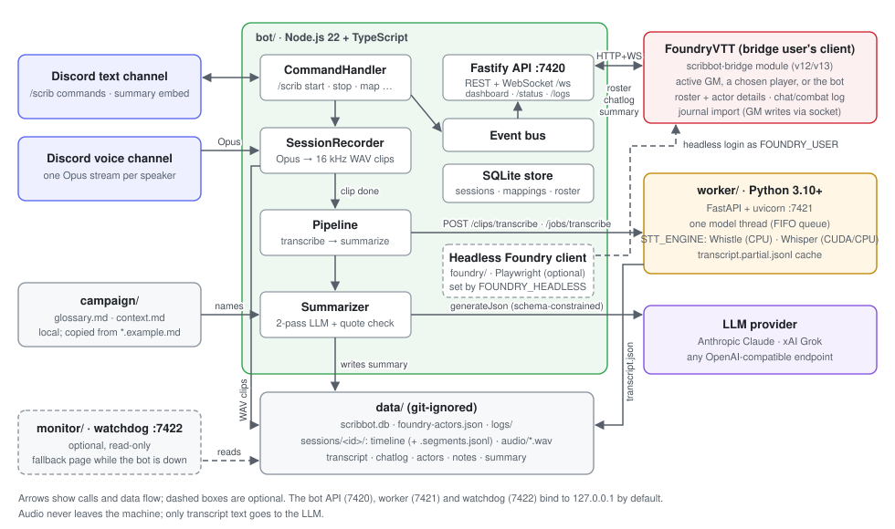
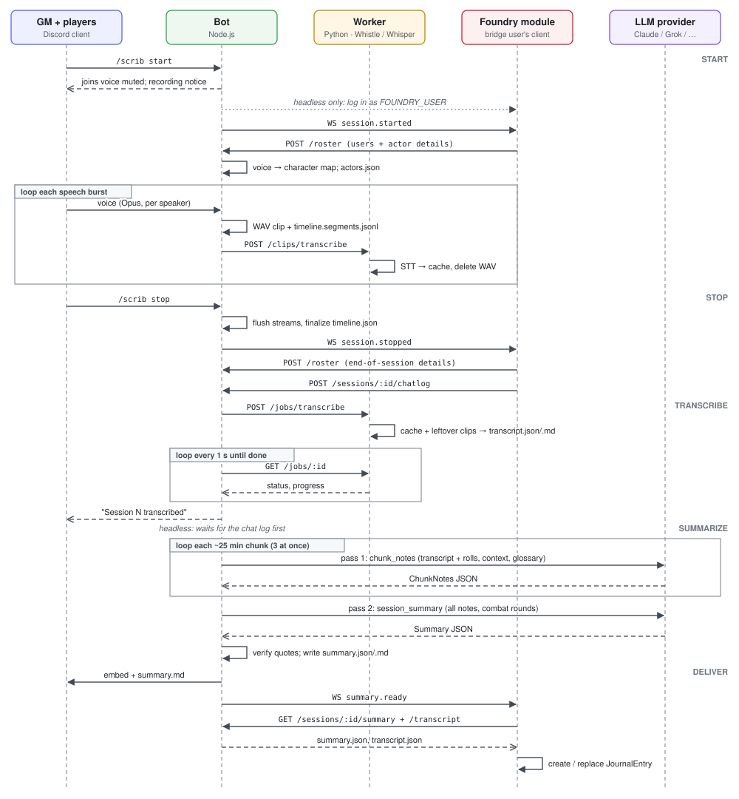
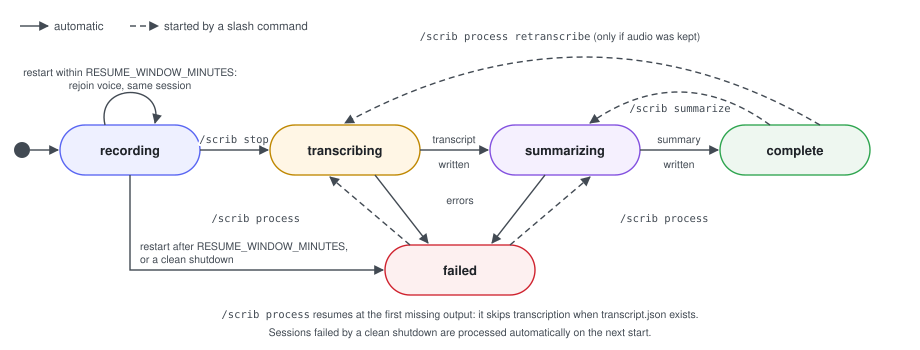
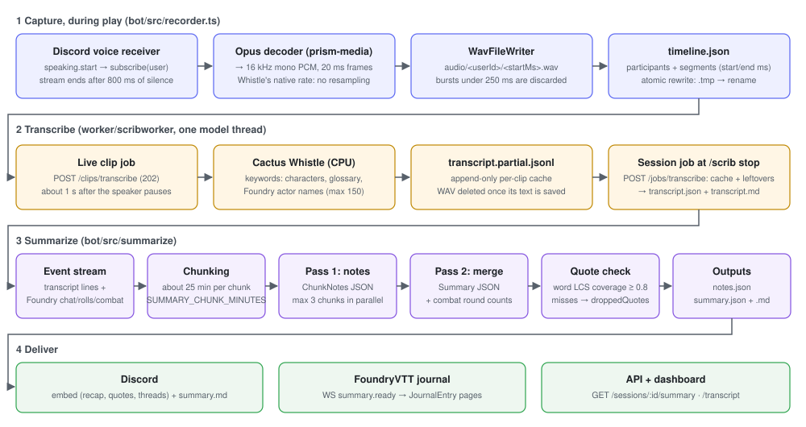

# ScribBot design document

| | |
|---|---|
| **Status** | Living document, describes the code as of 2026-11-01 |
| **Components** | `bot/` (Node.js), `worker/` (Python), `foundry-module/` (FoundryVTT), `shared/schemas/`, `monitor/` (optional), `.claude/skills/summarize-session/` (story write-ups) |
| **Audience** | Contributors and anyone deploying ScribBot for their table |

## 1. Purpose

ScribBot turns a tabletop RPG session played over Discord into a written record in FoundryVTT. It:

1. records each speaker in a Discord voice channel separately,
2. transcribes the audio locally on the CPU with Cactus Whistle,
3. labels every line with the speaker's Foundry character,
4. has an LLM write a structured adventure summary, merging speech with Foundry's dice rolls and combat log,
5. posts the summary to Discord and imports it into Foundry as a journal entry.

### Goals

- **No diarization needed.** Discord delivers one audio stream per user, so attribution is exact.
- **Audio stays local.** Speech-to-text runs on the GM's machine. Only transcript text goes to the configured LLM provider.
- **Faithful summaries.** Quotes are machine-checked against the transcript. Invented quotes are dropped.
- **Resumable.** Every stage writes its output to disk. A crash or a provider outage costs a retry, not a session.
- **Runs on a GM's PC.** No GPU, no cloud services other than Discord and the chosen LLM.

### Non-goals

- Real-time captions or live summaries during play.
- Multi-host or horizontally scaled deployments. One bot process serves one machine.
- Hosting audio or transcripts for players. Foundry's journal and Discord are the distribution channels.

## 2. Software stack

### Bot (`bot/`)

| Concern | Technology | Version |
|---|---|---|
| Runtime | Node.js | ≥ 22.12 (tested on 24.x) |
| Language | TypeScript (ES modules), run with `tsx` | 5.9 / tsx 4.23 |
| Discord gateway and slash commands | discord.js | 14.27 |
| Voice receive | @discordjs/voice | 0.19 |
| Opus decoding | prism-media + opusscript | 1.3 / 0.0.8 |
| HTTP API and WebSocket | Fastify + @fastify/websocket + @fastify/cors | 5.12 / 11.3 / 11.3 |
| Persistence | SQLite via better-sqlite3 (WAL mode) | 13.0 |
| Validation and JSON schemas | Zod | 4.6 |
| LLM: Anthropic | @anthropic-ai/sdk (structured outputs via `betaZodOutputFormat`) | 1.1 |
| LLM: xAI and OpenAI-compatible | openai SDK | 7.43 |
| Configuration | dotenv + Zod-validated env schema | 18.0 |
| Tests | Vitest | 5.0 |

### Transcription worker (`worker/`)

| Concern | Technology | Version |
|---|---|---|
| Runtime | Python | ≥ 3.10 (tested on 3.13) |
| Speech-to-text (`STT_ENGINE=whistle`, default) | Cactus Whistle (17 MB, Apache-2.0) through `cactus-needle`, CPU | 3.2.8 |
| Speech-to-text (`STT_ENGINE=whisper`, optional extra) | OpenAI Whisper (`WHISPER_MODEL`, default large-v3) through `faster-whisper` / CTranslate2, on CUDA (cuBLAS/cuDNN from the `nvidia-*` wheels, DLL folders added at load on Windows) or CPU (`WHISPER_DEVICE`) | 1.2.1 / 4.8.4 |
| HTTP API | FastAPI on uvicorn | 0.161 / 0.54 |
| Models and validation | Pydantic | 2.14 |
| Audio arrays | NumPy | 2.5 |
| Tests | pytest + httpx | 9.1 |

### FoundryVTT module (`foundry-module/`)

| Concern | Technology |
|---|---|
| Platform | FoundryVTT v12 (minimum) to v13 (verified) |
| Code | Browser JavaScript ES modules (`scripts/main.js`, `scripts/journal.js`), no build step |
| Transport | `fetch` with a bearer token, plus a native `WebSocket` to the bot |
| Storage | Foundry settings (client scope for URL and token) and user flags (`discordId`) |
| Distribution | Manifest URL install: `module.json` on `main` points `download` at `releases/scribbot-bridge.zip`, built by `package-foundry-module.ps1` |

### Cross-cutting

| Concern | Technology |
|---|---|
| Data contracts | JSON Schema files in `shared/schemas/`, generated from the Zod types with `npm run schemas` |
| Monitoring UI | Single static page `bot/public/dashboard.html` (plain HTML/JS, polls `/status` every 3 s) |
| LLM providers | Anthropic Claude (default `claude-opus-5-5`), xAI Grok (`grok-4`), or any OpenAI-compatible endpoint (OpenAI, Ollama, LM Studio, OpenRouter) |
| Story write-ups | Agent skill `.claude/skills/summarize-session/`: standard-library Python scripts plus a prompt, usable with any LLM (§8.1) |

## 3. Architecture

ScribBot is three processes plus Foundry:

| Process | Responsibility | Listens on |
|---|---|---|
| **Bot** (`bot/src/index.ts`) | Discord client, voice recording, pipeline orchestration, summarization, API for Foundry, dashboard | `127.0.0.1:7420` |
| **Worker** (`worker/scribworker`) | Loads Whistle once and transcribes clips on a single background thread | `127.0.0.1:7421` |
| **Foundry module** | Runs in the bridge user's browser (the active GM's by default, or a player chosen in the **Bridge user** setting, which can be the bot's own headless client, §3.2). It pushes the roster and chat log to the bot and pulls summaries into the journal. GM-only writes (journal entries, combat log) stay on the active GM's client, reached over Foundry's module socket when the bridge is a player | (client only) |
| **LLM provider** | Remote or local model behind `LLMProvider.generateJson()` | (external) |

### 3.1 Bot modules

| Module | Role |
|---|---|
| `commands.ts` | `/scrib` slash command handler. Owns the map of active recordings (one per guild) and posts results to Discord. Also resumes interrupted recordings after a restart, stops them cleanly on shutdown, and warns about a worker backlog. |
| `recorder.ts` | `SessionRecorder`: joins voice muted, subscribes to each speaker, writes one WAV per speech burst, journals each clip to `timeline.segments.jsonl` and snapshots `timeline.json`. Rejoins the channel by itself when the voice connection is lost. Never throws from a clip callback. |
| `recovery.ts` | Startup plan for sessions the last process left mid-flight (resume, mark failed, or process), and the default session for `/scrib process`. |
| `timeline.ts` | `readTimeline()`: the snapshot plus journal-only clips. |
| `merge.ts` | Merges a continuation session into the one it continues (`/scrib merge`, `npm run merge`). |
| `links.ts` | Which Foundry "Discord ID" flags to write from `/scrib map` (`roster.link`). |
| `fsutil.ts` | Atomic writes (`.tmp` + rename) with retries on Windows sharing errors. |
| `logfile.ts` | Daily log files in `DATA_DIR/logs`. |
| `pipeline.ts` | `processSession()` runs transcription, then summarization, and updates session status. `makeLiveTranscriber()` sends clips during play. `purgeExpiredAudio()` enforces retention. |
| `worker-client.ts` | HTTP client for the worker: fire-and-forget clip jobs, and session jobs polled every second. Polls survive a worker restart: unreachable calls are retried for 5 minutes, and a job the worker no longer knows (404) is resubmitted. |
| `summarize/` | Prompt building, chunking, provider adapters, quote verification and Markdown rendering. |
| `participants.ts` | Resolves a Discord user to a Foundry character (see §7). |
| `db.ts` | `Store`: SQLite access with versioned migrations. |
| `events.ts` | In-process `EventEmitter` bus. Its events are forwarded to Foundry over the WebSocket. |
| `api/server.ts`, `api/status.ts`, `api/pipeline.ts` | Fastify routes, token auth, CORS, `/status` health aggregation with warnings, and its `pipeline` block (queue, conversion, quality, alerts, shutdown advice). |
| `monitor.ts` | Captures console output into a ring buffer for `/logs` and the dashboard, and into the daily log file. |
| `campaign.ts` | Loads `campaign/glossary.md` and `context.md` and builds STT keyword lists. Both are git-ignored; `ensureCampaignFiles()` creates them at startup from the committed `*.example.md` templates. |
| `foundry/` | Optional headless Foundry client (§3.2): `client.ts` is the lifecycle, `playwright.ts` the browser driver, `index.ts` builds it from config. |

### 3.2 Headless Foundry client

With `FOUNDRY_HEADLESS=session|always`, the bot joins the world itself instead of relying on a person's browser. It drives a headless Chromium-family browser with `playwright-core` (an optional dependency, imported only when this is on; on Windows it uses the installed Edge, so nothing is downloaded) and logs in as a dedicated Foundry player, `FOUNDRY_USER` (default `ScribBot`), which the GM selects as the module's **Bridge user**. The module doesn't change: it runs in the bot's browser, so a player bridge's rules apply (no whispers or blind rolls in the chat log; journals and the combat log are written by the active GM's client).

**Join** (`playwrightLauncher()`): open `FOUNDRY_URL/join` (a redirect to `/setup` or `/auth` means no world is running), pick the user from the join list by name, log in, and wait for `game.ready`. The canvas is turned off for that client (`core.noCanvas`, written to `localStorage` before Foundry's scripts run), since the bridge only reads game data and WebGL in a headless browser costs CPU. The bot then checks that the module is active and that this user is the bridge user, writes the module's client settings (`botUrl` = `FOUNDRY_BOT_URL`, `apiToken` = `API_TOKEN`) in a throwaway browser profile, and waits until the module's WebSocket to the bot is open (`api.status()`, module 0.4.0+; older modules are assumed connected). The user agent is a normal desktop Chrome one, and private-network checks are off so a page served from the internet can reach the bot on loopback.

**Lifecycle** (`HeadlessFoundry`): the client is wanted for a set of reasons, and stays joined while any is present.

| Reason | Added | Removed |
|---|---|---|
| `always` | at start, in `always` mode | at shutdown |
| `session N` | `session.started` | the module's `POST /chatlog` for that session (`chatlog.received`), or `FOUNDRY_CHATLOG_WAIT_SECONDS` after `session.stopped` |
| `import` | `summary.ready` while not joined, or summaries left over from a previous run | after trying each pending import |

While joined, the module handles `summary.ready` itself. Otherwise the client joins, calls the module's `api.importSummary()` for each pending summary (unless **Import summaries automatically** is off), and leaves. A summary no GM could take stays in `DATA_DIR/foundry-headless.json` and is retried on the next join. A failed join is retried with backoff (15 s doubling to 5 min; 5 min for configuration errors such as a wrong password or the wrong bridge user), and the error is shown on `/status`. Every 30 s the client checks the page; two failed checks in a row, a crash, or Foundry sending it back to `/join` makes it log out and join again. All browser work runs on one serialized queue, and nothing on it can throw into the recording path.

**Chat log before summarizing.** `processSession()` calls `beforeSummary`, which waits on `awaitChatlog()` for a session the client joined for and that has just stopped. Other sessions (and a later `/scrib summarize`) never wait.

`npm run foundry` (`bot/scripts/foundry-join.ts`) joins once with the same settings and prints the result (`-- --stay` keeps it joined, `-- --headed` shows the window).

## 4. Session lifecycle

1. **Start.** `/scrib start` creates a session row (`recording`), joins the caller's voice channel muted and undeafened, posts a recording notice with the speaker-to-character map, and emits `session.started`.
2. **During play.** Each `speaking.start` opens an Opus subscription that ends after 800 ms of silence. The clip is decoded to 16 kHz mono and written as `audio/<userId>/<startMs>.wav`. The segment is appended (and fsynced) to `timeline.segments.jsonl` *before* the clip is handed to the worker, so the timeline always lists clips that may later be deleted. `timeline.json` itself is a snapshot, written atomically on a new speaker, every 30 s while clips arrive, and at stop; readers (`readTimeline()` in the bot, `load_timeline()` in the worker, the watchdog) union the two by file. This keeps the I/O linear instead of rewriting a growing file per clip, and makes a failed rename (Windows `EPERM`/`EBUSY` while another process holds the file; retried with backoff) harmless. With `DELETE_AUDIO_AFTER_TRANSCRIBE=true`, the clip is transcribed immediately and its WAV deleted.
3. **Stop.** `/scrib stop` flushes open streams, finalizes the timeline, and emits `session.stopped`. The bridge user's Foundry module responds by uploading the chat, roll and combat log for the session's time window. With the headless client (§3.2), the summary waits for that upload.
4. **Transcribe.** The bot submits a session job. The worker reuses every cached clip result, transcribes any leftovers (for example, clips recorded while it was down), and writes `transcript.json` and `transcript.md`. The Markdown is self-contained for any LLM or reader: an "About this transcript" section (what it is, when, the speech-to-text model and language, the line format, that names may be misheard), a player-to-character table, then the timed lines. With `AUTO_SUMMARIZE=false` (the default) the session is marked `complete` here, the bot posts where the transcript is saved, and nothing is sent to an LLM; steps 5 and 6 run only on `/scrib summarize`.
5. **Summarize.** Two LLM passes produce `summary.json`, and quotes are verified (see §8).
6. **Deliver.** The bot posts an embed with `summary.md` attached, and emits `summary.ready`. If auto-import is enabled, the module fetches the summary and transcript and creates or replaces a `JournalEntry` in the configured folder.

### 4.1 Session status

The status is stored in `sessions.status` and broadcast as `session.status` events. Because each stage checks for its output file before running, resuming never redoes finished work.

**After a restart** (`planRestart()` in `recovery.ts`):
- A session still `recording` whose timeline files changed less than `RESUME_WINDOW_MINUTES` ago is resumed once Discord is ready: the bot rejoins its voice channel and continues the **same session** on the same clock (`startedAt`, participants and segments loaded from disk), and posts the gap in the text channel. If the channel is gone or empty, or the resume fails, it is marked `failed` and the table is told.
- Older `recording` sessions, and any left `transcribing` or `summarizing`, are marked `failed` with the exact `/scrib process session:N`, and the text channel is told.
- A clean shutdown (SIGINT/SIGTERM/SIGBREAK) stops every recording first, bounded at 10 s: open clips are closed and `timeline.json` is finalized with `endedAt`. Those sessions are marked `failed` with a shutdown note and processed automatically on the next start.

`unhandledRejection` is logged and ignored; `uncaughtException` triggers the same clean shutdown and exits non-zero, so the supervisor in `start.ps1` restarts the bot. `error` listeners on the Discord client, its shards and every voice connection keep network faults from ending the process.

## 5. Data pipeline

### Key parameters

| Parameter | Value | Where |
|---|---|---|
| Sample rate | 16 kHz mono, 16-bit PCM | `recorder.ts` (`SAMPLE_RATE`) |
| End-of-utterance silence | 800 ms | `recorder.ts` (`SILENCE_MS`) |
| Minimum clip length | 250 ms | `recorder.ts` (`MIN_SEGMENT_MS`) |
| STT keywords | up to 150 (characters, glossary, Foundry actors) | `campaign.ts` (`sttKeywords`) |
| Summary chunk length | 25 min (`SUMMARY_CHUNK_MINUTES`) | `summarize/format.ts` |
| Chunk concurrency | 3 | `summarize/summarize.ts` |
| Quote match threshold | 0.8 word coverage, windows of up to 3 lines by the same speaker | `summarize/quotes.ts` |

## 6. Data model

### 6.1 Session folder (`data/sessions/<id>/`)

| File | Writer | Contents | Lifetime |
|---|---|---|---|
| `timeline.json` | Bot | Participants, segments (`discordId`, `startMs`, `endMs`, `file`). A snapshot: see the journal | Kept |
| `timeline.segments.jsonl` | Bot | One segment per line, appended and fsynced as each clip is finished | Kept |
| `audio/<user>/*.wav` | Bot | One clip per speech burst | Deleted on transcription, or `AUDIO_RETENTION_DAYS` after summary |
| `transcript.partial.jsonl` | Worker | Per-clip STT cache (append-only) | Removed once `transcript.json` is written |
| `transcript.json` / `.md` | Worker (rewritten by a merge) | Timestamped lines with speaker, character and GM flag | Kept |
| `*.premerge-<n>` | Bot (`/scrib merge`) | A's timeline, transcript and chat log before session `n` was merged in | Kept |
| `chatlog.json` | Bot (from Foundry) | Chat messages, rolls, combats, and the world's game system (`system`: Foundry's `game.system` id, title and version; module 0.5.0+, else `null`) | Kept |
| `actors.json` | Bot (from Foundry) | Character and NPC details as they stood this session: name, type, race, sex/gender, age, height, weight, class(es) and levels, max HP. Seeded from `data/foundry-actors.json` at `/scrib start`, then replaced by the roster syncs Foundry sends at session start, during play and at stop | Kept |
| `notes.json` | Bot | Pass 1 chunk notes | Kept |
| `summary.json` / `.md` | Bot | Final summary plus `droppedQuotes`, provider and model | Kept |
| `story/` | `summarize-session` skill (§8.1) | Evidence pack (`pack.md`, `chunks/`, `noise.md`, `lines.json`, `prompt-full.md`) and the story `summary.story.md` | Kept; `prepare.py` never overwrites an existing `summary.story.md` |

All JSON contracts are defined in Zod (`bot/src/types.ts`, `bot/src/summarize/schema.ts`) and exported to `shared/schemas/*.schema.json`. The worker mirrors them in Pydantic (`worker/scribworker/models.py`).

### 6.2 SQLite (`data/scribbot.db`)

| Table | Key | Purpose |
|---|---|---|
| `sessions` | `id` | Guild, channels, per-guild `number`, `status`, `error`, timestamps, `audio_purged` |
| `mappings` | `(guild_id, discord_id)` | Manual `/scrib map` and `/scrib gm` assignments |
| `roster` | `foundry_user_id` | Latest Foundry users with their assigned actor and Discord ID flag |

Migrations are an ordered array applied by `PRAGMA user_version`.

## 7. Speaker identity

Discord streams are tagged by user ID, so the only problem is mapping a user to a character. `resolveParticipant()` applies, in order:

1. an explicit `/scrib map` for that guild (character name or actor),
2. the Foundry user they are mapped to, and that user's assigned character,
3. a Foundry user whose `discordId` flag matches them (set in the module's **Link Discord accounts** menu),
4. otherwise, their Discord display name.

GMs (by `/scrib gm` or Foundry's `isGM`) are labelled `GM (Name)`. The prompt tells the model that the GM narrates and voices all NPCs. Bots in the channel are ignored.

## 8. Summarization design

- **Provider abstraction.** `LLMProvider.generateJson({system, prompt, schema, effort})` returns schema-validated JSON. The Anthropic adapter uses structured outputs with server-side fallback for classifier refusals. The OpenAI-compatible adapter serves xAI and local models.
- **Event stream.** Transcript lines and Foundry events (`[FOUNDRY ROLL]`, chat, combat start and end) are merged into one time-ordered stream, so the model can anchor fights and checks to reliable mechanical facts.
- **Two passes.** Pass 1 turns each chunk into `ChunkNotes` (scenes, events, combats, in-character quotes, NPCs, loot, threads). Pass 2 merges all notes, with combat round counts from Foundry, into the final `Summary`. This keeps each prompt bounded however long the session is.
- **In-character filtering.** The system prompt separates in-character speech from table talk and requires character names, never player names.
- **Quote verification.** Each quote is scored by the longest common subsequence of words against windows of 1 to 3 consecutive lines by the same speaker (Whistle splits sentences at pauses). Quotes scoring below 0.8 are moved to `droppedQuotes`. In-character Foundry chat is also a valid quote source.
- **Campaign context.** `context.md` (setting, party, story so far) and `glossary.md` go into every prompt, so the model can correct misheard names.

### 8.1 Story write-ups (`summarize-session` skill)

Separate from `/scrib summarize` and from the bot process, `.claude/skills/summarize-session/` turns a finished session into a high-fantasy, story-style write-up with any LLM: an agent, a chat model the user pastes into, or a local model. It reads the session's files and `data/scribbot.db` but writes only to `data/sessions/<id>/story/` and `data/nicknames.json`; nothing is imported into Foundry.

| Piece | Role |
|---|---|
| `prepare.py <number\|id\|latest> [more…]` | Builds the evidence pack. Drops Whisper hallucinations (stock outros, caption credits, decoder loops, wrong-script lines, filler) with a reason each in `noise.md`, trims outros off real speech, tags lines for the writer (`ooc?`, `mech`, `dmg`, `item?`, `todo?`, `ruling?`…), merges Foundry rolls and combats, and numbers every line (`L0123`). Several sessions are stitched in time order with a `[RECORDING RESUMED …]` marker. Unknown nicknames stop it with exit code 2 until confirmed (`--nickname`, kept in `data/nicknames.json`). Names the game system (from `chatlog.json`, else inferred from `systems/<id>/` paths and compendium links in the chat HTML) and lists every spell and ability card Foundry posted, in the pack's "Style" section. Starts `summary.story.md` from `template.md` only if it doesn't exist |
| `template.md` | The story skeleton. Its `##` headings, in order, are the fixed sections; each `<note>` tells the writer what goes there |
| `layout.py` | Reads `template.md` and holds the 800-character summary limit and the table columns, shared by `prepare.py` and `verify.py` |
| `PROMPT.md` | Instructions for the writing model: modern (not archaic) fantasy voice, spells and abilities called by the game system's names, in-character vs. table talk, dialogue vs. described action, no damage numbers, no line IDs in the output |
| `verify.py <summary.story.md>` | Checks sections and order, the summary length, the character table against Foundry, the NPC table (named NPCs only, matching any Foundry sheet), verbatim quotes not taken from dropped lines, every spell Foundry shows was cast named in the story (a warning), no line IDs, no subheadings in "The story", no real names, game numbers or (for the fantasy style) engineering wording on the story side. Prints `PASS` or each `FAIL`/`WARN` |

Sections, always in this order: High level summary, Characters in Session (from Foundry), NPCs in Session, Objectives Completed, The story, Major events, Battles, Iconic items and loot, Memorable quotes, Deeds of the party, Loose threads, then At the table and Chronicler's notes. Only the last two (and the Player column) may name players or the GM. See the skill's `SKILL.md` for small-context models and the full hallucination rules.

## 9. Interfaces

### 9.1 Slash commands

| Command | Effect |
|---|---|
| `/scrib start` / `stop` | Begin or end recording in the caller's voice channel |
| `/scrib map @user <character>`, `unmap`, `gm @user` | Manage speaker mappings (autocompletes from the Foundry roster). Picking a Foundry user also writes the Discord ID into Foundry (`roster.link`) |
| `/scrib mappings`, `status`, `sessions` | Information |
| `/scrib process [session] [retranscribe]` | Resume a failed session or redo it. Default: the latest failed session, else the latest one not recording; merged-away sessions are refused |
| `/scrib summarize [session]` | Re-run only the summary. Refuses up front when the LLM setup would fail |
| `/scrib merge a:<N> b:<M>` | Merge continuation session M into N (Manage Server); see §10 |

### 9.2 Bot HTTP API (`:7420`)

Every route except `/health`, `/` and `/dashboard` requires `Authorization: Bearer <API_TOKEN>`, or `?token=` for the WebSocket, because browsers can't set headers on upgrades.

| Method and path | Purpose |
|---|---|
| `GET /health` | Liveness |
| `GET /`, `/dashboard` | Monitoring page (the token is entered in the page) |
| `GET /status`, `GET /logs?after=<seq>` | Component health, warnings, sessions, the `pipeline` block, and log lines |
| `GET /ws` | WebSocket: `hello`, `session.started`, `session.stopped`, `session.status`, `summary.ready`, `roster.request`, `roster.link` |
| `POST /roster` | Foundry users, assigned characters, Discord ID flags and actor names, plus for each character and NPC actor its race, sex/gender, age, height, weight, classes and levels, and max HP (`foundry-module/scripts/actors.js`), saved to `data/foundry-actors.json`. The actors are also saved as the session's `actors.json`: the session named by an optional `sessionId` (the module sends one on `session.started` and `session.stopped`), else the one recording. Replies with `links`: how many `roster.link` corrections it sent |
| `GET /sessions`, `GET /sessions/:id` | Session list and detail (`:id` may be `latest`) |
| `POST /sessions/:id/chatlog` | Upload chat, roll and combat log, plus the game system (body limit 25 MB) |
| `GET /sessions/:id/summary`, `/transcript` | Serve `summary.json` and `transcript.json` |

**`roster.link`** carries `links: [{ foundryUserId, discordId, ifDiscordId? }]`: Discord IDs to store as Foundry users' "Discord ID" flag. It is sent after a `/scrib map`, `/scrib unmap` or `/scrib gm` that touches a Foundry user, and after every `POST /roster` for each mapped Foundry user whose reported flag is missing or different, so mappings made while Foundry was offline fill in by themselves. `/scrib map` wins over a different flag. A clear (`discordId: null`) only removes the flag if it still holds `ifDiscordId`. The GM mapping is written only when the world has exactly one GM user. Names are never matched. In Foundry only a GM may edit other users, so a player bridge relays the event to the active GM's client (`linkDiscord` over the module socket); `planDiscordLinks()` in `roles.js` decides which flags change, and the bridge re-syncs the roster afterwards.

**`/status` → `pipeline`** (`api/pipeline.ts`, ported from the watchdog):
- `queue`: the worker's queue depth, clips recorded but not yet converted, the conversion rate (the larger of clips added to session caches and the worker's live done/failed counters) and queue trend (per minute, over the last 5 minutes, after 20 s), the time to catch up, seconds since anything was converted, and `stalled` (work queued, nothing converted for 2 min).
- `conversions`: for each session that is recording, transcribing, summarizing, processing, or failed with a worker cache changed in the last 12 h, clips converted vs recorded, read from the worker's `transcript.partial.jsonl`. Recorded clips come from the recorder's live count while it records (the pipeline never opens `timeline.json` then) and from `readTimeline()` otherwise. Each carries `quality`: clips whose every line is noise, suspected hallucinations (stock silence phrases, or ≥ 80% of words from the hotword list), and the most repeated texts.
- `alerts`: worker stalled; no new clip in a live recording for 3 min; queue growing during a recording; live clips failed; a failed session the worker is still converting; ≥ 15% suspected hallucinations.
- `shutdown`: `no` while a recording is live; `wait` while a session is being transcribed or summarized or the worker queue isn't empty; otherwise `safe`.

`/status` also reports each recording's voice `connection` (`connected`, `reconnecting`, `lost`), and `foundry.speakers`: how many of the latest session's speakers resolve to a character or the GM by any route, next to `foundry.rosterLinked` (users with the Foundry flag set).

### 9.2a Optional watchdog (`monitor/scribmonitor.py`, `:7422`)

A standalone, read-only Python program (standard library only) for the times the bot itself is down. The bot's dashboard on `:7420` is the one page to watch. While the bot answers, `/` and `/dashboard` redirect there. While it doesn't, they serve `monitor/offline.html`, which polls the watchdog's `/status`: the same shape as the bot's, built locally from the worker's `/health`, sessions and roster counts from `data/scribbot.db` (opened `mode=ro`), disk and `.env`, plus `monitor.pipeline` with the crash notice, worker queue and shutdown advice. `GET /monitor/recent-log` returns the last 40 lines of its log copy. The bot's `/status` is fetched with `API_TOKEN` from `.env`, so the token stays server-side. Requests whose `Host` isn't loopback are refused (DNS rebinding). Nothing depends on it.

A background sampler thread polls every 5 s. It remembers what was recording, so a bot that disappears mid-session is called out (with a hint when `timeline.json.tmp` was left behind), and while the bot is online it copies new `/logs` entries to `MONITOR_LOG_DIR` (default `<DATA_DIR>/logs`) as `scribbot-YYYY-MM-DD.log`, keeping 14 days. `monitor-state.json` in that folder records the bot's start time and the last copied sequence number, so lines are copied once across restarts of either side. It counts clips with the segment journal too, and never opens `timeline.json` while the bot is recording.

With the bot's own log files (S9), its crash fixes and the supervisor (S3), the watchdog's crash role mostly goes away; `docs/assessment/05` C3 decides whether to delete it after a few sessions without a crash.

### 9.3 Worker HTTP API (`:7421`)

| Method and path | Purpose |
|---|---|
| `GET /health` | Model, device, language, queue depth, live clip counters, `paused`/`pausedReason`, `recovered` (clips re-queued at start), `current` (the clip being transcribed and for how long), `consecutiveFailures`, `modelReloads`, `stats` (last 5 min of model calls: clips/min, avg and p95 seconds, real-time factor, skipped by VAD, filler phrases dropped, % with usable text), Whisper `options` |
| `POST /clips/transcribe` | Queue one clip (returns 202). Idempotent through the cache |
| `POST /jobs/transcribe` | Build the full transcript for a session folder. Returns a job ID |
| `GET /jobs/:id` | Job status and progress |
| `POST /pause`, `POST /resume` | Hold or release the queue; the clip in progress finishes. A JSON body is required (`{}` or `{"reason": "…"}`), so a web page can't trigger them cross-site. Pausing doesn't survive a restart |

**Short clips (Whisper).** Most clips are one to two seconds long, and Whisper always processes a 30-second window. Each clip is therefore screened with Silero VAD on the CPU first, and clips without speech never reach the model. The rest are decoded with `vad_filter`, temperatures `0.0/0.4/0.8` instead of six steps, `max_new_tokens` of 8 per second of audio plus 16 (at most 200), beam size `WHISPER_BEAM_SIZE`, and at most `WHISPER_MAX_HOTWORDS` hotwords. Clips under `WHISPER_HOTWORDS_MIN_SECONDS` get no hotwords at all, because on near-silence Whisper writes the hotword list back out. On session clips this took silent sub-second clips from 19–56 s to about 0.01 s, with identical text on real speech (see `docs/assessment/01`). After decoding, a clip whose whole text is a stock silence phrase ("thank you", "you", "bye"…) is dropped when it is shorter than `WHISPER_FILLER_MAX_SECONDS` **and** its mean word probability is below `WHISPER_FILLER_MAX_PROBABILITY` (01 R9).

**Queue order.** One thread, a priority queue, FIFO within a priority: the startup model load, then live clips, then the end-of-session job of a session that had live clips in the last 30 minutes and clips re-queued after a restart, then everything else (for example `/scrib process` on an old session).

**Model faults.** Errors that aren't about the file (missing, unreadable WAV) count as model failures. After `WORKER_RELOAD_AFTER_FAILURES` in a row the transcription thread drops the model and loads it again; if that fails, the worker exits with code 3 so `start-worker.ps1` restarts it. A watchdog thread logs any clip running longer than `WORKER_SLOW_CLIP_SECONDS`. The worker logs to `DATA_DIR/logs/worker-YYYY-MM-DD.log` (`LOG_RETENTION_DAYS`).

**Recovery after a restart.** The queue is in memory. On start, the worker re-queues every clip under `DATA_DIR/sessions/*/audio/` that has no entry in the session's cache, for sessions without `transcript.json` touched in the last `WORKER_RECOVER_HOURS`. Those clips get glossary hotwords and `DELETE_AUDIO_AFTER_TRANSCRIBE`. It skips WAVs modified in the last 2 minutes, which the bot may still be writing. It never opens `timeline.json`, because the bot may be renaming over it. A session job the bot was polling when the worker restarted is resubmitted by the bot (it gets a 404 for the old job ID) and reuses everything already transcribed.

The worker rejects any `sessionDir` outside `DATA_DIR`, and any language outside the supported set (en, de, fr, es, it, nl, pl).

## 10. Security and privacy

- **Consent.** `/scrib start` posts a recording notice. Groups must agree to be recorded before play.
- **Local audio.** WAVs never leave the machine. By default each one is deleted seconds after it's transcribed.
- **Network exposure.** Both services bind to `127.0.0.1`. Remote Foundry hosts (Forge and others) work because browsers treat `http://localhost` as a secure origin. To expose the bot elsewhere, put it behind an HTTPS proxy or tunnel.
- **Authentication.** A shared `API_TOKEN` is compared with `timingSafeEqual`. `/status` warns while it is still `change-me`. The token is stored only in the bridge user's browser (Foundry client-scope setting) and never returned by the API.
- **CORS.** Only `FOUNDRY_ORIGINS` is allowed, with methods limited to GET and POST.
- **Path safety.** Session IDs are resolved through the database before any file access. The worker confines paths to `DATA_DIR`.
- **Secrets in status.** `/status` reports which kind of credential each provider has (for example `api key` or `ant profile`), never the value. A provider without credentials raises a warning before the session ends, not when summarizing fails.
- **LLM data.** Transcript text and campaign notes go to the configured provider. A local OpenAI-compatible model keeps everything on the machine.

## 11. Reliability

| Failure | Handling |
|---|---|
| Worker down during play | Live clip calls fail silently (one log line). The session job at stop transcribes the waiting WAVs. |
| Worker or bot crash mid-transcription | `transcript.partial.jsonl` keeps finished clips, so only the rest are redone. A waiting bot retries unreachable polls for 5 minutes and resubmits a job the restarted worker doesn't know; the failure message names the session and the clips are kept. |
| Process exits | `start.ps1` and `start-worker.ps1` restart a crashed bot or worker after 5 s (at most 5 times in 10 minutes); a clean exit ends the loop. Daily log files in `DATA_DIR/logs` keep what led up to it, and the bot logs its exit code and reason. |
| Worker falls behind | The bot posts once per session in the text channel when the queue is more than `BACKLOG_WARN_MINUTES` behind. |
| Bot crash or restart mid-session | Within `RESUME_WINDOW_MINUTES`, the bot rejoins and keeps recording the same session (§4.1). Otherwise the session is marked `failed`, the table is told, and `/scrib process` resumes from what is on disk. If a game still ends up as two sessions, once both are transcribed, `/scrib merge` (or `npm run merge`, `bot/src/merge.ts`) folds it into the first: B's lines and clips shifted by `B.startedAt − A.startedAt`, a `discordId: "scribbot"` marker line at the gap, participants unioned, chat and combats de-duplicated by `id`, A's files backed up as `*.premerge-<B number>`, B marked `complete` with error `Merged into session N` (the pipeline refuses to process it). B's WAVs are copied into A only if all of them still exist, so a retranscribe of A keeps B (but loses the marker line). |
| LLM error, rate limit or refusal | Session marked `failed` with the error posted to Discord. `/scrib summarize` retries without re-transcribing. The Anthropic adapter retries on the API's fallback model for refusals. |
| Partial writes | `timeline.json`, `transcript.json`, `chatlog.json`, `actors.json` and `foundry-actors.json` are written to `.tmp` and renamed; the bot retries the rename on `EPERM`/`EBUSY`/`EACCES` for about 2 s. A clip callback never throws: a failed snapshot is logged and the journal still lists the clip. |
| Voice disconnect | The recorder waits 5 s for the connection to recover, then closes open clips and rejoins after 2, 5, 10, 20 and 30 s, then every minute, posting in the text channel when it drops, comes back, or isn't back after 5 tries. `/status` shows the connection state and warns while nothing is being recorded. |
| Headless Foundry client can't join | Retried with backoff; `/status` shows why (no world running, wrong password, not the bridge user, module can't reach the bot). Recording is unaffected; the summary goes without the chat log after at most `FOUNDRY_CHATLOG_WAIT_SECONDS`. |
| Headless client kicked or Foundry restarted | Detected by the 30 s health check or the page leaving `/game`; the client logs out and joins again. |
| Several GMs online | With no bridge user set, only the active GM's module handles WebSocket events. With one set, only that user's module connects. |
| Player bridge, no GM online | Summaries are queued and handed to the first GM who connects, or created by the player if Foundry lets them create journal entries. The chat log excludes whispers and blind rolls. |
| Player bridge, relay | Module socket messages reach every client, so only the summary and transcript are relayed, never whispers. The GM's client accepts requests only from the configured bridge user and rebuilds pages with `buildJournalPages`, which escapes all text. |
| Disk growth | Audio retention (`AUDIO_RETENTION_DAYS`) is checked at startup and every 6 hours. The dashboard warns below 1 GB free. |

## 12. Configuration

All configuration lives in `.env` at the repo root (see `.env.example`), is validated by Zod in `bot/src/config.ts`, and is read by the worker in `worker/scribworker/config.py`.

| Group | Variables |
|---|---|
| Discord | `DISCORD_TOKEN`, `DISCORD_CLIENT_ID`, `DISCORD_GUILD_ID` |
| Storage | `DATA_DIR`, `CAMPAIGN_DIR` |
| API | `API_HOST`, `API_PORT`, `API_TOKEN`, `FOUNDRY_ORIGINS` |
| Headless Foundry client | `FOUNDRY_HEADLESS` (`off`/`session`/`always`), `FOUNDRY_URL`, `FOUNDRY_USER` (`ScribBot`), `FOUNDRY_PASSWORD`, `FOUNDRY_BROWSER`, `FOUNDRY_BOT_URL`, `FOUNDRY_CHATLOG_WAIT_SECONDS` (120) |
| Worker | `WORKER_URL`, `STT_LANGUAGE`, `WHISTLE_WEIGHTS`, `STT_ENGINE` (`whistle`/`whisper`), `WHISPER_MODEL`, `WHISPER_DEVICE` (`cuda`/`cpu`), `WHISPER_COMPUTE_TYPE`, `WHISPER_BEAM_SIZE`, `WHISPER_MAX_HOTWORDS`, `WHISPER_HOTWORDS_MIN_SECONDS`, `WHISPER_VAD`, `WHISPER_VAD_THRESHOLD`, `WHISPER_FILLER_MAX_SECONDS`, `WHISPER_FILLER_MAX_PROBABILITY`, `WORKER_RECOVER_HOURS`, `WORKER_RELOAD_AFTER_FAILURES`, `WORKER_SLOW_CLIP_SECONDS` (also reads `DELETE_AUDIO_AFTER_TRANSCRIBE`, `CAMPAIGN_DIR`, `LOG_RETENTION_DAYS`) |
| Recovery and logs | `RESUME_WINDOW_MINUTES` (30), `BACKLOG_WARN_MINUTES` (10), `LOG_RETENTION_DAYS` (14, shared by bot and worker) |
| Watchdog (optional) | `MONITOR_PORT`, `MONITOR_LOG_DIR` |
| LLM | `LLM_PROVIDER`, `LLM_MODEL`, `ANTHROPIC_API_KEY`, `XAI_API_KEY`, `OPENAI_BASE_URL`, `OPENAI_API_KEY`, `SUMMARY_CHUNK_MINUTES`, `AUTO_SUMMARIZE` (default `false`) |
| Retention | `DELETE_AUDIO_AFTER_TRANSCRIBE`, `AUDIO_RETENTION_DAYS` |

## 13. Testing

| Suite | Command | Covers |
|---|---|---|
| Bot | `cd bot && npm test` | API auth, roster and `roster.link`, chat log, status and warnings, the pipeline block, participant resolution, pipeline with a fake provider, chunking, quote verification, merge, rename retries, clip finalization when `timeline.json` can't be written, the segment journal, resume and shutdown plans, worker polling across a restart, log files, Foundry journal page building (`journal.test.js`), Discord-link planning (`roles.test.js`), and the headless Foundry client's lifecycle and join helpers with a fake browser (`foundry-headless.test.ts`) |
| Headless join | `cd bot && npm run foundry` | A real login to Foundry as `FOUNDRY_USER` with the configured browser |
| Bot types | `cd bot && npm run typecheck` | Strict TypeScript across `src/`, `scripts/` and `test/` |
| Worker | `cd worker && .venv\Scripts\python -m pytest` | Clip-to-line conversion and labels, noise filtering, pause splitting, cache resume, live clip then delete, 48 to 16 kHz resampling, path confinement in the API, the segment journal, the filler filter, queue priorities, model reload after repeated errors, log files |
| Monitor | `cd monitor && ..\worker\.venv\Scripts\python -m pytest` | `.env` parsing, relaying with the token, offline fallback shape, read-only database access, pipeline (conversion counts, rate/ETA, shutdown verdict, quality, alerts, no live `timeline.json` reads), log copy across restarts, redirect to the bot's dashboard while it's up and the fallback page while it's down, loopback `Host` check, token never in responses |
| Merge | `npm run merge -- <A> <B>` | Folds continuation session B into A (`bot/test/merge.test.ts` covers it on fixture copies) |
| End to end without Discord | `npx tsx scripts/transcribe-dir.ts <dir>`, then `npm run summarize -- <id>` | Real Whistle and a real LLM on a recorded session folder (`data/sessions/fixture-tts` is a TTS fixture) |

## 14. Known limitations and open questions

- **Chat log upload races transcription (without the headless client).** With a person's browser as the bridge, the pipeline doesn't wait for the module's `POST /chatlog`, so a slow upload could arrive after summarization has read the folder. The headless client (§3.2) closes this: the summary waits for the upload, up to `FOUNDRY_CHATLOG_WAIT_SECONDS`.
- **Headless client limits.** It joins as a player, so the combat log still needs a GM online during play, and journals are created only while a GM is online. Login pages other than Foundry's own (e.g. The Forge's account login) aren't supported. Foundry allows one login per user, so nobody else may use the `ScribBot` user while the bot needs it.
- **One transcriber thread.** Neither engine is shared across threads (Whistle isn't thread-safe), so the worker loads the model and processes one clip at a time on a single thread. The model is loaded at startup on that thread; a load failure is reported as `loadError` in `GET /health` and as a `/status` warning. That is plenty for a single table, but several simultaneous guilds would queue.
- **No re-transcription after deletion.** With the default live deletion, adding glossary names later can't improve an old transcript. Only the summary can be redone.
- **Single machine.** The bot, worker and data directory are assumed to share a filesystem: the worker receives local paths, not audio bytes.
- **Languages.** Whistle covers seven European languages. Other languages need a different STT backend behind the same worker API.
- **One recording per guild.** Recordings are keyed by guild ID.
- **Resumed recordings don't mark the gap in the transcript.** After a restart the same session continues, but nothing in `transcript.md` says speech is missing between two lines; only the Discord message and the timestamps show it. (`/scrib merge` does insert a marker line.)
- **The supervisor is a console loop.** `start.ps1` restarts a crashed bot or worker, but closing its window or logging off ends everything. Run the same commands under NSSM, WinSW or a Task Scheduler task to survive that.
- **Worker priorities are coarse.** A long end-of-session job runs to completion once started; live clips that arrive meanwhile wait behind it.
