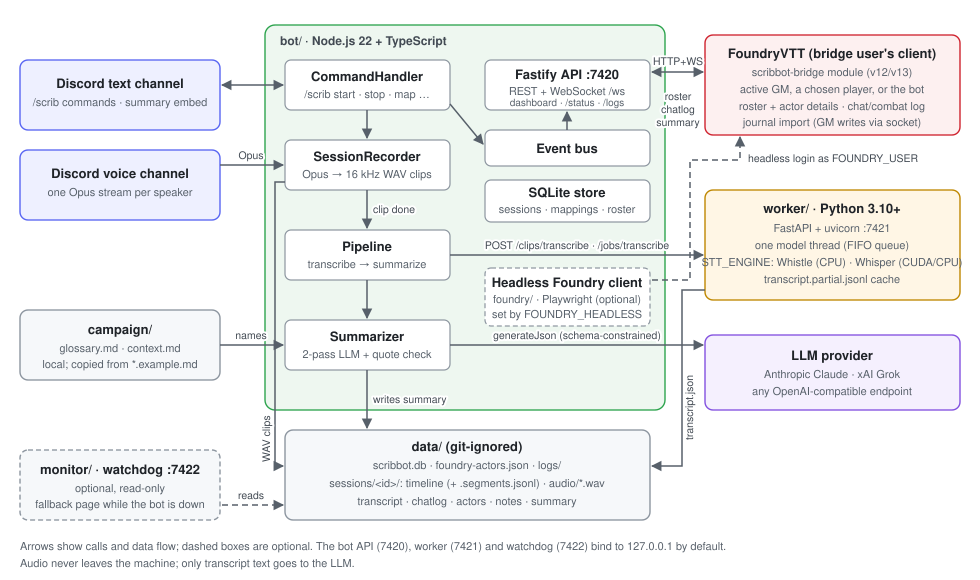
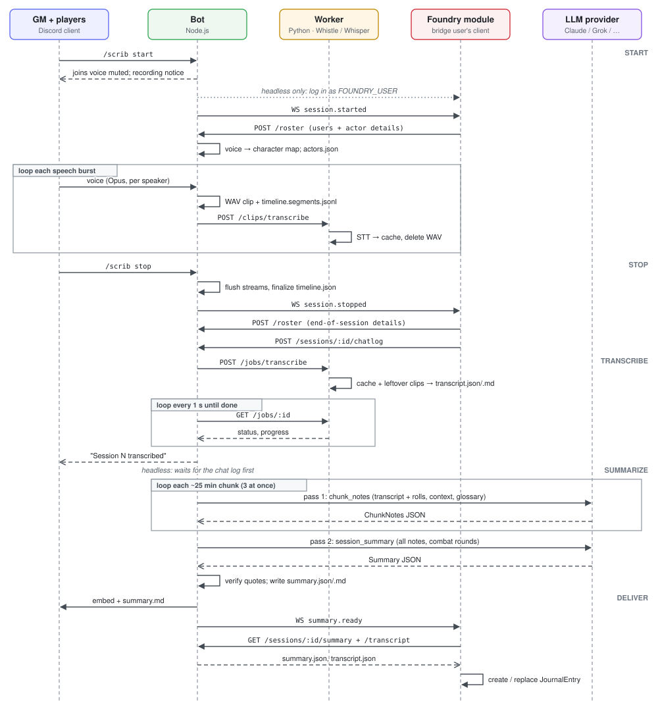
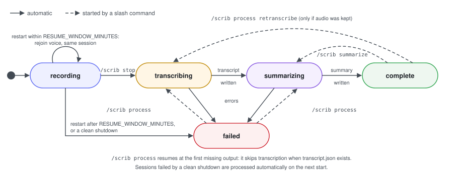
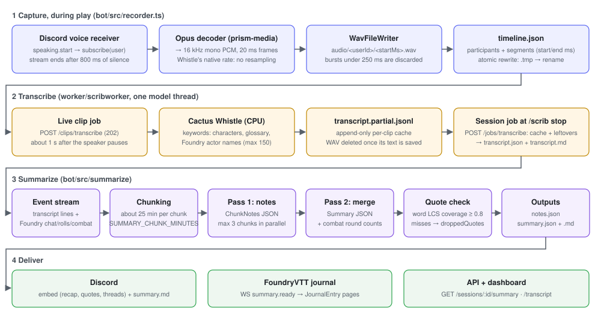

# ScribBot design document

| | |
|---|---|
| **Status** | Living document, describes the code as of 2026-11-01 |
| **Components** | `bot/` (Node.js), `worker/` (Python), `foundry-module/` (FoundryVTT), `shared/schemas/`, `console/` (the Console, optional), `.claude/skills/summarize-session/` (story write-ups) |
| **Audience** | Contributors and anyone deploying ScribBot for their table |

## 1. Purpose

ScribBot turns a tabletop RPG session played over Discord into a written record in FoundryVTT. It:

1. records each speaker in a Discord voice channel separately,
2. transcribes the audio locally on the CPU with Cactus Whistle,
3. labels every line with the speaker's Foundry character,
4. has an LLM write a structured adventure summary, merging speech with Foundry's dice rolls and combat log,
5. imports it into Foundry as a journal entry once someone has reviewed it, and posts progress (never the content) to Discord.

### Goals

- **No diarization needed.** Discord delivers one audio stream per user, so attribution is exact.
- **Audio stays local.** Speech-to-text runs on the GM's machine. Only transcript text goes to the configured LLM provider.
- **Faithful summaries.** Quotes are machine-checked against the transcript. Invented quotes are dropped.
- **Resumable.** Every stage writes its output to disk. A crash or a provider outage costs a retry, not a session.
- **Runs on a GM's PC.** No GPU, no cloud services other than Discord and the chosen LLM.

### Non-goals

- Real-time captions or live summaries during play.
- Multi-host or horizontally scaled deployments. One bot process serves one machine.
- Hosting audio or transcripts for players. Foundry's journal and Discord are the distribution channels.

## 2. Software stack

### Bot (`bot/`)

| Concern | Technology | Version |
|---|---|---|
| Runtime | Node.js | ≥ 22.12 (tested on 24.x) |
| Language | TypeScript (ES modules), run with `tsx` | 5.9 / tsx 4.23 |
| Discord gateway and slash commands | discord.js | 14.27 |
| Voice receive | @discordjs/voice | 0.19 |
| Opus decoding | prism-media + opusscript | 1.3 / 0.0.8 |
| HTTP API and WebSocket | Fastify + @fastify/websocket + @fastify/cors | 5.12 / 11.3 / 11.3 |
| Persistence | SQLite via better-sqlite3 (WAL mode) | 13.0 |
| Validation and JSON schemas | Zod | 4.6 |
| LLM: Anthropic | @anthropic-ai/sdk (structured outputs via `betaZodOutputFormat`) | 1.1 |
| LLM: xAI and OpenAI-compatible | openai SDK | 7.43 |
| Configuration | dotenv + Zod-validated env schema | 18.0 |
| Tests | Vitest | 5.0 |

### Transcription worker (`worker/`)

| Concern | Technology | Version |
|---|---|---|
| Runtime | Python | ≥ 3.10 (tested on 3.13) |
| Speech-to-text (`STT_ENGINE=whistle`, default) | Cactus Whistle (17 MB, Apache-2.0) through `cactus-needle`, CPU | 3.2.8 |
| Speech-to-text (`STT_ENGINE=whisper`, optional extra) | OpenAI Whisper (`WHISPER_MODEL`, default large-v3) through `faster-whisper` / CTranslate2, on CUDA (cuBLAS/cuDNN from the `nvidia-*` wheels, DLL folders added at load on Windows) or CPU (`WHISPER_DEVICE`) | 1.2.1 / 4.8.4 |
| HTTP API | FastAPI on uvicorn | 0.161 / 0.54 |
| Models and validation | Pydantic | 2.14 |
| Audio arrays | NumPy | 2.5 |
| Tests | pytest + httpx | 9.1 |

### FoundryVTT module (`foundry-module/`)

| Concern | Technology |
|---|---|
| Platform | FoundryVTT v12 (minimum) to v13 (verified) |
| Code | Browser JavaScript ES modules (`scripts/main.js`, `scripts/journal.js`), no build step |
| Transport | `fetch` with a bearer token, plus a native `WebSocket` to the bot |
| Storage | Foundry settings (client scope for URL and token) and user flags (`discordId`) |
| Distribution | Manifest URL install: `module.json` on `main` points `download` at `releases/scribbot-bridge.zip`, built by `package-foundry-module.ps1` |

### Cross-cutting

| Concern | Technology |
|---|---|
| Data contracts | JSON Schema files in `shared/schemas/`, generated from the Zod types with `npm run schemas` |
| Monitoring UI | Single static page `bot/public/dashboard.html` (plain HTML/JS, polls `/status` every 3 s) |
| Management UI | The Console (`console/`, §9.2a): Python standard library server plus plain ES modules, no build step |
| Settings catalog | `bot/src/settings-catalog.ts`, exported to `shared/schemas/settings.json` for the Console's Configuration tab |
| LLM providers | Anthropic Claude (default `claude-opus-5-5`), xAI Grok (`grok-4`), any OpenAI-compatible endpoint (OpenAI, Ollama, LM Studio, OpenRouter), or a signed-in coding-agent CLI: OpenAI Codex (`codex exec`), Google Antigravity (`agy`, default `gemini-3.8-flash`) Claude Code (`claude -p`) or the xAI Grok CLI (`grok`) |
| Story write-ups | Agent skill `.claude/skills/summarize-session/`: standard-library Python scripts plus a prompt, usable with any LLM (§8.1) |

## 3. Architecture



ScribBot is three processes plus Foundry, and the optional Console:

| Process | Responsibility | Listens on |
|---|---|---|
| **Bot** (`bot/src/index.ts`) | Discord client, voice recording, pipeline orchestration, summarization, API for Foundry, dashboard | `127.0.0.1:7420` |
| **Worker** (`worker/scribworker`) | Loads Whistle once and transcribes clips on a single background thread | `127.0.0.1:7421` |
| **Console** (`console/scribconsole`, optional) | Desktop management page: sessions, campaigns, monitoring, `.env` settings. Drives the bot through `/admin/*`; nothing depends on it (§9.2a) | `127.0.0.1:7422` |
| **Foundry module** | Runs in the bridge user's browser (the active GM's by default, or a player chosen in the **Bridge user** setting, which can be the bot's own headless client, §3.2). It pushes the roster and chat log to the bot and pulls summaries into the journal. GM-only writes (journal entries, combat log) stay on the active GM's client, reached over Foundry's module socket when the bridge is a player | (client only) |
| **LLM provider** | Remote or local model behind `LLMProvider.generateJson()` | (external) |

### 3.1 Bot modules

| Module | Role |
|---|---|
| `commands.ts` | `/scrib` slash command handler. Owns the map of active recordings (one per guild) and posts results to Discord. Also resumes interrupted recordings after a restart, stops them cleanly on shutdown, and warns about a worker backlog. Start, stop, process, merge and map are shared methods (`beginRecording`, `endRecording`, `checkProcess`, `mergeInto`, `setMapping`…) that the Console's routes call too, so both interfaces check and say the same things. |
| `recorder.ts` | `SessionRecorder`: joins voice muted, subscribes to each speaker, writes one WAV per speech burst, journals each clip to `timeline.segments.jsonl` and snapshots `timeline.json`. Rejoins the channel by itself when the voice connection is lost. Never throws from a clip callback. |
| `recovery.ts` | Startup plan for sessions the last process left mid-flight (resume, mark failed, or process), and the default session for `/scrib process`. |
| `timeline.ts` | `readTimeline()`: the snapshot plus journal-only clips. |
| `merge.ts` | Merges a continuation session into the one it continues (`/scrib merge`, `npm run merge`). `unusableReason()` says why a trashed or merged session can't be used. |
| `links.ts` | Which Foundry "Discord ID" flags to write from `/scrib map` (`roster.link`). |
| `fsutil.ts` | Atomic writes (`.tmp` + rename) with retries on Windows sharing errors. |
| `logfile.ts` | Daily log files in `DATA_DIR/logs`. |
| `pipeline.ts` | `processSession()` runs transcription, then summarization, and updates session status. `makeLiveTranscriber()` sends clips during play. `purgeExpiredAudio()` enforces retention. `processBlocker()` is the one statement of when a session can't be processed; the slash commands and the Console check it before starting. |
| `worker-client.ts` | HTTP client for the worker: fire-and-forget clip jobs, and session jobs polled every second. Polls survive a worker restart: unreachable calls are retried for 5 minutes, and a job the worker no longer knows (404) is resubmitted. |
| `summarize/` | Prompt building, chunking, provider adapters, quote verification and Markdown rendering. `defaults.ts` holds each provider's default model (also published to the Console through `settings.json`); `readiness.ts` says whether summaries can run (model, credential source, problems), for `/status` and before `/scrib summarize`. |
| `participants.ts` | Resolves a Discord user to a Foundry character (see §7). |
| `db.ts` | `Store`: SQLite access with versioned migrations. |
| `events.ts` | In-process `EventEmitter` bus. Its events are forwarded to Foundry over the WebSocket. |
| `api/server.ts`, `api/status.ts`, `api/pipeline.ts` | Fastify routes, token auth, CORS, `/status` health aggregation with warnings, and its `pipeline` block (queue, conversion, quality, alerts, shutdown advice). |
| `api/admin.ts` | The Console's `/admin/*` routes (§9.2), wrapping the same `CommandHandler` methods the slash commands use. |
| `trash.ts` | The trash: moving a session folder to `DATA_DIR/trash/`, restoring it (renumbering on a clash), emptying the trash (`TRASH_RETENTION_DAYS`). |
| `settings-catalog.ts` | Every `.env` variable with its label, help, type, default, the processes that read it and the values known to cost speed; exported to `shared/schemas/settings.json`. |
| `monitor.ts` | Captures console output into a ring buffer for `/logs` and the dashboard, and into the daily log file. |
| `story.ts` | Finds a session's story write-up (§8.1), its own or a stitched one whose `lines.json` covers it, refuses unfinished ones, lists its images, and emits `story.ready`. |
| `campaign.ts` | Loads a campaign's `glossary.md` and `context.md` and builds STT keyword lists. `campaignNoteFile()` picks the campaign's own (`CAMPAIGN_DIR/<campaign folder>/`) or else the shared file; `campaignFolderOfPath()` finds the campaign of a session or recording folder. All are git-ignored; `ensureCampaignFiles()` creates the shared ones at startup from the committed `*.example.md` templates. |
| `foundry/` | Optional headless Foundry client (§3.2): `client.ts` is the lifecycle, `playwright.ts` the browser driver, `index.ts` builds it from config and `foundryTarget()` (the Foundry server of the campaign being played). |
| `api/origins.ts` | `allowedOrigins()`: the web origins allowed to call the bot (CORS), `FOUNDRY_ORIGINS` plus each campaign's Foundry server, read per request. |

### 3.2 Headless Foundry client

With `FOUNDRY_HEADLESS=session` (the default) or `always`, the bot joins the world itself instead of relying on a person's browser (`off`). It drives a headless Chromium-family browser with `playwright-core` (an optional dependency, imported only when this is on; on Windows it uses the installed Edge, so nothing is downloaded) and logs in as a dedicated Foundry player, which the GM selects as the module's **Bridge user**. Where it joins is read at each join (`foundryTarget()`): the Foundry address, user and password set for the campaign being played (§6.1, the Console's Campaign tab), reduced to the server's base (`foundryBaseUrl()` drops a pasted `/game`, `/join` or `/setup` and keeps a route prefix). A join page that answers with an HTTP error is reported as a wrong address. A campaign without an address joins nothing (state `idle`, a `/status` warning, `url: null`): its address never falls back to `.env`, so one campaign's server is never used for another and the address lives only in the git-ignored database. The user and password fall back to `FOUNDRY_USER` (default `ScribBot`) and `FOUNDRY_PASSWORD`; `FOUNDRY_URL` is used only while no campaign is being played. The module doesn't change: it runs in the bot's browser, so a player bridge's rules apply (no whispers or blind rolls in the chat log; journals and the combat log are written by the active GM's client).

**Join** (`playwrightLauncher()`): open `FOUNDRY_URL/join` (a redirect to `/setup` or `/auth` means no world is running), pick the user from the join list by name, log in, and wait for `game.ready`. The canvas is turned off for that client (`core.noCanvas`, written to `localStorage` before Foundry's scripts run), since the bridge only reads game data and WebGL in a headless browser costs CPU. The bot then checks that the module is active and that this user is the bridge user, writes the module's client settings (`botUrl` = `FOUNDRY_BOT_URL`, `apiToken` = `API_TOKEN`) in a throwaway browser profile, and waits until the module's WebSocket to the bot is open (`api.status()`, module 0.4.0+; older modules are assumed connected). The user agent is a normal desktop Chrome one, and private-network checks are off so a page served from the internet can reach the bot on loopback.

**Lifecycle** (`HeadlessFoundry`): the client is wanted for a set of reasons, and stays joined while any is present.

| Reason | Added | Removed |
|---|---|---|
| `always` | at start, in `always` mode | at shutdown |
| `session N` | `session.started` | the module's `POST /chatlog` for that session (`chatlog.received`), or `FOUNDRY_CHATLOG_WAIT_SECONDS` after `session.stopped` |
| `import` | `summary.ready` or `story.ready` while not joined, or imports left over from a previous run | after trying each pending import |

**Campaigns.** When the campaign being played or its Foundry server changes, the Console's admin route calls `retarget()`: a page on another server or user is logged out and the new one joined, except while a recording is joined for (or waiting for its chat log), when the switch waits for it to end; a pending retry is tried again at once. A summary or story is only imported into the world of the session's campaign (`belongs()`, comparing the campaign's world id with the joined world); others stay pending until that world is joined. `/status` warns when the joined world isn't the one the campaign expects.

While joined, the module handles `summary.ready` and `story.ready` itself. Otherwise the client joins, calls the module's `api.importSummary()` for each pending summary (unless **Import summaries automatically** is off) or `api.importStory()` for each pending story (always: a story is only announced on request), and leaves. An import no GM could take stays in `DATA_DIR/foundry-headless.json` (stories as `story:<id>`) and is retried on the next join. A failed join is retried with backoff (15 s doubling to 5 min; 5 min for configuration errors such as a wrong password or the wrong bridge user), and the error is shown on `/status`. Every 30 s the client checks the page; two failed checks in a row, a crash, or Foundry sending it back to `/join` makes it log out and join again. All browser work runs on one serialized queue, and nothing on it can throw into the recording path.

**Chat announcements.** With `FOUNDRY_ANNOUNCE=true` (the default), the client posts an out-of-character chat message as its user once it has joined, saying why from its reasons ("ScribBot joined to record session 12.", "…to import a session journal.", "…and is standing by."), and another just before it logs out ("ScribBot has finished and is leaving.", or "…is shutting down…" when the bot stops). When the page is already gone (kicked, crashed, Foundry restarted) it leaves without a word. The messages carry the `scribbot-announce` class, and the summarizer (`summarize/format.ts`) and the story skill's `prepare.py` skip them in the chat log. They need no module change.

**Chat log before summarizing.** `processSession()` calls `beforeSummary`, which waits on `awaitChatlog()` for a session the client joined for and that has just stopped. Other sessions (and a later `/scrib summarize`) never wait.

`npm run foundry` (`bot/scripts/foundry-join.ts`) joins once with the same settings and prints the result (`-- --stay` keeps it joined, `-- --headed` shows the window).

## 4. Session lifecycle



1. **Start.** `/scrib start` creates a session row (`recording`) in the campaign being played (§6.1), joins the caller's voice channel muted and undeafened, posts a recording notice with the campaign's name and speaker-to-character map, and emits `session.started`.
2. **During play.** Each `speaking.start` opens an Opus subscription that ends after 800 ms of silence. The clip is decoded to 16 kHz mono and written as `audio/<userId>/<startMs>.wav`. The segment is appended (and fsynced) to `timeline.segments.jsonl` *before* the clip is handed to the worker, so the timeline always lists clips that may later be deleted. `timeline.json` itself is a snapshot, written atomically on a new speaker, every 30 s while clips arrive, and at stop; readers (`readTimeline()` in the bot, `load_timeline()` in the worker, the Console) union the two by file. This keeps the I/O linear instead of rewriting a growing file per clip, and makes a failed rename (Windows `EPERM`/`EBUSY` while another process holds the file; retried with backoff) harmless. With `DELETE_AUDIO_AFTER_TRANSCRIBE=true`, the clip is transcribed immediately and its WAV deleted.
3. **Stop.** `/scrib stop` flushes open streams, finalizes the timeline, and emits `session.stopped`. The bridge user's Foundry module responds by uploading the chat, roll and combat log for the session's time window. With the headless client (§3.2), the summary waits for that upload.
4. **Transcribe.** The bot submits a session job. The worker reuses every cached clip result, transcribes any leftovers (for example, clips recorded while it was down), and writes `transcript.json` and `transcript.md`. The Markdown is self-contained for any LLM or reader: an "About this transcript" section (what it is, when, the speech-to-text model and language, the line format, that names may be misheard), a player-to-character table, then the timed lines. With `AUTO_SUMMARIZE=false` (the default) the session is marked `complete` here, the bot posts where the transcript is saved, and nothing is sent to an LLM; steps 5 and 6 run only on `/scrib summarize`.
5. **Summarize.** Two LLM passes produce `summary.json`, and quotes are verified (see §8).
6. **Review.** With `REVIEW_BEFORE_FOUNDRY=true` (the default) the bot tells the text channel the summary is ready (status only, §9.1a) and holds it for review (§8.2): nothing goes to Foundry until someone approves it, in the Console or with `/scrib approve`. The reviewer can edit it, or ask the LLM to correct it (`/scrib revise`), and each new version needs approving.
7. **Deliver.** Once approved (or straight away with `REVIEW_BEFORE_FOUNDRY=false`), the bot emits `summary.ready`. If auto-import is enabled (approving from the Console or with `/scrib approve` always imports), the module fetches the summary and transcript and creates or replaces a `JournalEntry` in the configured folder.

### 4.1 Session status



The status is stored in `sessions.status` and broadcast as `session.status` events. Because each stage checks for its output file before running, resuming never redoes finished work.

**After a restart** (`planRestart()` in `recovery.ts`):
- A session still `recording` whose timeline files changed less than `RESUME_WINDOW_MINUTES` ago is resumed once Discord is ready: the bot rejoins its voice channel and continues the **same session** on the same clock (`startedAt`, participants and segments loaded from disk), and posts the gap in the text channel. If the channel is gone or empty, or the resume fails, it is marked `failed` and the table is told.
- Older `recording` sessions, and any left `transcribing` or `summarizing`, are marked `failed` with the exact `/scrib process session:N`, and the text channel is told.
- A clean shutdown (SIGINT/SIGTERM/SIGBREAK) stops every recording first, bounded at 10 s: open clips are closed and `timeline.json` is finalized with `endedAt`. Those sessions are marked `failed` with a shutdown note and processed automatically on the next start.

`unhandledRejection` is logged and ignored; `uncaughtException` triggers the same clean shutdown and exits non-zero, so the supervisor in `start.ps1` restarts the bot. `error` listeners on the Discord client, its shards and every voice connection keep network faults from ending the process.

## 5. Data pipeline



### Key parameters

| Parameter | Value | Where |
|---|---|---|
| Sample rate | 16 kHz mono, 16-bit PCM | `recorder.ts` (`SAMPLE_RATE`) |
| End-of-utterance silence | 800 ms | `recorder.ts` (`SILENCE_MS`) |
| Minimum clip length | 250 ms | `recorder.ts` (`MIN_SEGMENT_MS`) |
| STT keywords | up to 150 (characters, glossary, Foundry actors) | `campaign.ts` (`sttKeywords`) |
| Summary chunk length | 25 min (`SUMMARY_CHUNK_MINUTES`) | `summarize/format.ts` |
| Chunk concurrency | 3 | `summarize/summarize.ts` |
| Quote match threshold | 0.8 word coverage, windows of up to 3 lines by the same speaker | `summarize/quotes.ts` |

## 6. Data model

### 6.1 Folders (`data/campaigns/<world>/sessions/<session id>/`)

A **campaign** is one Foundry world; its folder is the world's id (`game.world.id`), never renamed (the Console shows the world's title, or an alias set there). A campaign can also be made in the Console's Campaign tab before its world is known: its folder is then named after it, and the first world that syncs while it is being played becomes its world. Each campaign has its own Foundry server login, character mappings (§7) and notes (`CAMPAIGN_DIR/<folder>/context.md` and `glossary.md`, falling back to the shared `CAMPAIGN_DIR/context.md` and `glossary.md`; the bot, worker, Console and story skill resolve them the same way from the session's folder). A **session** is one game, numbered within its campaign and filed under its first recording's id (`2026-11-01-6ae0bcc6`: the date it started, so folders sort in play order). The id never changes, so the folder never does either: the number is a database value only, and renumbering (restoring from the trash, moving to another campaign) changes no path. Merging moves the continuation's recordings into the game's folder, which keeps its name. A database row is one **recording**: one Discord capture from `/scrib start` to `/scrib stop`. A game has one recording, or several when a continuation was merged in.

```
data/campaigns/<world>/sessions/<session id>/     the game: what people open
  transcript.md/.json  chatlog.json  actors.json  notes.json  summary.md/.json  story/
  recordings/<recording id>/                       what the recorder and worker write
    timeline.json  timeline.segments.jsonl  audio/  transcript.partial.jsonl
    transcript.json/.md  chatlog.json  actors.json    (this recording alone)
    from-session-013/                              a merged recording's own summary/story, kept
```

The database records each recording's folder (`sessions.dir`), and `sessionPaths(id)` (`bot/src/paths.ts`) resolves through it: `recording` for inputs, `dir` for the game. Rows from before the layout migration have no `dir` and resolve to the old flat `data/sessions/<id>/`, which is both. Folders from before this naming were `sessions/012/`; the layout migration renames them to the id (database backed up, files untouched). The game's files are **built from its recordings** by `composeSession()` (`bot/src/layout.ts`) after transcription, after a chat log upload and after a merge: each recording's lines shifted onto the game's clock with a `discordId: "scribbot"` marker line at each gap, chat logs combined (messages and combats once by `id`, the later combat copy wins), and the latest recording's actors. Composing never changes a recording, so it is safe to repeat.

**Recording folder**

| File | Writer | Contents | Lifetime |
|---|---|---|---|
| `timeline.json` | Bot | Participants, segments (`discordId`, `startMs`, `endMs`, `file`). A snapshot: see the journal | Kept |
| `timeline.segments.jsonl` | Bot | One segment per line, appended and fsynced as each clip is finished | Kept |
| `audio/<user>/*.wav` | Bot | One clip per speech burst | Deleted on transcription, or `AUDIO_RETENTION_DAYS` after summary |
| `transcript.partial.jsonl` | Worker | Per-clip STT cache (append-only) | Removed once `transcript.json` is written |
| `transcript.json` / `.md` | Worker | This recording's lines, timed from its own start | Kept |
| `chatlog.json` | Bot (from Foundry) | Chat messages, rolls, combats for this recording's time window, and the world's game system (`system`; module 0.5.0+, else `null`) | Kept |
| `actors.json` | Bot (from Foundry) | Character and NPC details: name, type, race, sex/gender, age, height, weight, class(es) and levels, max HP. Seeded from `data/foundry-actors.json` at `/scrib start`, replaced by the roster syncs at start, during play and at stop | Kept |

**Game folder**

| File | Writer | Contents |
|---|---|---|
| `transcript.json` / `.md`, `chatlog.json`, `actors.json` | Bot (`composeSession`) | Built from the recordings, as above. Rebuilt any time |
| `notes.json` | Bot | Pass 1 chunk notes |
| `summary.json` / `.md` | Bot | Final summary plus `droppedQuotes`, provider and model; `editedAt` and `revisions` (feedback asked of the LLM) from review (§8.2) |
| `story/` | `summarize-session` skill (§8.1) | Evidence pack (`pack.md`, `chunks/`, `noise.md`, `lines.json`, `prompt-full.md`), the story `summary.story.md`, and any images it shows. `prepare.py` never overwrites an existing `summary.story.md` |

**New recordings** go to the **campaign being played**: the one chosen in the Console's Campaign tab (`campaigns.selected_at`), else the campaign of the Foundry world that synced most recently (`campaigns.last_seen_at`), else the campaign of the newest session, else `_unassigned` (no world seen yet); the Console's New recording dialog can pick another. A recording keeps the campaign it started in. Each roster sync creates or updates its world's campaign (`world`, and `worldTitle` from module 0.7.1). The Console's **Move to another campaign** moves a game's folder and renumbers it there.

**Layout migration** (`bot/src/migrate-layout.ts`; `npm run migrate-layout [-- --apply]` with the bot stopped, or the Console's **Update folder layout** while nothing is recording, processing or queued in the worker). It plans first and changes nothing until applied. Then it copies `data/sessions`, `data/trash` and the database (`VACUUM INTO`) to `data/backups/layout-<time>/`, and moves one game at a time, recording each move in the database as it lands. Each session goes to the campaign of the world its chat log names (else the most named, else the newest seen), keeping its number unless that number is taken. A game that had a session merged into it by the old merge gets its own pre-merge files back from `*.premerge-<n>` (the earliest) as its recording, the clip copies an old merge made (`audio/<user>/m<n>-*.wav`) are removed, and the merged session's folder moves into its `recordings/`. Sessions in the trash are restructured in place, so restoring them lands in the campaign folder. Folders not in the database (`fixture-tts`) are left alone. It also renames game folders still named by number (`sessions/012/`) to the game's id: one rename per game, then each recording's `dir`; only the database is backed up for those, since no file changes, and a game in the trash only has its `dir` updated, so it is restored under its id.

A game trashed from the Console moves, folder and all recordings, to `DATA_DIR/trash/<id>/` until it is restored or the trash is emptied. A recording merged into a game can't be trashed on its own. New sessions are numbered after the highest session that isn't in the trash. If restoring meets a newer session with the same number, the later of the two (by start time) moves up one, along with the sessions straight after it (`restorePlan()` in `bot/src/trash.ts`). Folders are named by id, so only numbers change. Foundry journal entries already posted keep their old names.

All JSON contracts are defined in Zod (`bot/src/types.ts`, `bot/src/summarize/schema.ts`) and exported to `shared/schemas/*.schema.json`. The worker mirrors them in Pydantic (`worker/scribworker/models.py`).

### 6.2 SQLite (`data/scribbot.db`)

| Table | Key | Purpose |
|---|---|---|
| `sessions` | `id` | One recording: guild, channels, `number` (per campaign; per guild before migration 4), `status`, `error`, timestamps, `audio_purged`; from migration 4: `campaign_id`, `dir` (its recording folder, §6.1), `merged_into_id` (the game it belongs to); from migration 2: `title`, `notes`, `deleted_at` / `purged_at` (the trash; the row stays so merges still resolve, `listSessions`/`latestSession` leave trashed ones out, and `nextNumber` skips them, so a trashed number can be taken again), `summary_sent_at` / `story_sent_at` (last `summary.ready` / `story.ready`); from migration 6: `summary_approved_at` / `summary_approved_hash`, `story_approved_at` / `story_approved_hash` (review before Foundry, §8.2: the hash of the file approved, kept on the row holding a stitched story); from migration 3: `summary_journal_at` / `summary_journal_name`, `story_journal_at` / `story_journal_name` (Foundry's confirmation, `POST /sessions/:id/journal`). The Console shows "in Foundry ✓" when the confirmation is at least as new as the last send, else "sent, not confirmed yet" |
| `campaigns` | `id` | One per Foundry world (migration 4): `world_id`, `folder` (fixed), `title` (from Foundry), `alias` (set in the Console), `last_seen_at` (last roster sync: where new recordings go when none is chosen). `_unassigned` has no world. From migration 5: `foundry_url`, `foundry_user`, `foundry_password` (the campaign's Foundry login; no address: ScribBot doesn't join Foundry for it; no user or password: `.env`'s; the password is never returned by any route) and `selected_at` (chosen as the campaign being played; the latest wins) |
| `mappings` | `(campaign_id, guild_id, discord_id)` | Manual `/scrib map` and `/scrib gm` assignments, per campaign from migration 5. `campaign_id` 0 is shared by every campaign (all mappings made before migration 5); a campaign's own mapping for someone hides the shared one |
| `meta` | `key` | Small values: `roster_world`, the world of the last roster sync (its Foundry users can only be mapped in that world's campaign) |
| `roster` | `foundry_user_id` | Latest Foundry users with their assigned actor and Discord ID flag |

Migrations are an ordered array applied by `PRAGMA user_version`.

## 7. Speaker identity

Discord streams are tagged by user ID, so the only problem is mapping a user to a character. Mappings belong to a campaign: a recording uses its campaign's (`Store.getMappings(guild, campaign)`: the campaign's own, plus the shared ones it doesn't override), and `/scrib map`, `unmap`, `gm` and `mappings` act on the campaign being played (`playingCampaignId()`; shared, campaign 0, while there is none). A Foundry user can only be picked, and its "Discord ID" flag written, when the synced roster is that campaign's world. `resolveParticipant()` applies, in order:

1. an explicit `/scrib map` for that guild in the recording's campaign (character name or actor),
2. the Foundry user they are mapped to, and that user's assigned character,
3. a Foundry user whose `discordId` flag matches them (set in the module's **Link Discord accounts** menu),
4. otherwise, their Discord display name.

GMs (by `/scrib gm` or Foundry's `isGM`) are labelled `GM (Name)`. The prompt tells the model that the GM narrates and voices all NPCs. Bots in the channel are ignored.

## 8. Summarization design

- **Provider abstraction.** `LLMProvider.generateJson({system, prompt, schema, effort})` returns schema-validated JSON. The Anthropic adapter uses structured outputs with server-side fallback for classifier refusals. The OpenAI-compatible adapter serves xAI and local models. The CLI adapter (`summarize/cli-agent.ts`) runs `codex exec`, `agy --print`, `claude -p` or `grok --prompt-file` once per request in an empty temp folder with the CLI's sandbox on, has the CLI enforce the request's JSON Schema (`--output-schema` / `--json-schema` with a file; Claude Code's `--json-schema` takes it inline, about 5 KB, and runs with `--tools "" --strict-mcp-config --disable-slash-commands --setting-sources "" --no-session-persistence`, not `--bare`, which accepts only an API key; Grok takes the schema inline and the prompt from a file in the temp folder, since its single-turn mode doesn't read stdin, and runs with `--tools= --disable-web-search --no-subagents --no-plan --permission-mode dontAsk`), sends the prompt on stdin (a chunk is too long for a Windows command line; `agy` takes it as a stream-json `user` message), and validates the reply with Zod. Each request is stopped after 20 minutes. The child gets an allowlisted environment (`childEnv()`: `PATH`, home/temp/locale, proxy and CA variables, `XDG_*`, `DBUS_SESSION_BUS_ADDRESS`, `CODEX_HOME`, `CLAUDE_CONFIG_DIR`), because dotenv puts every `.env` secret in `process.env` and these agents can run commands. `resolveCli()` finds the CLI the same way for a run and for `/status`, and starts it without a shell: a program directly by absolute path, a `.js` file or an npm cmd-shim (`SET "_prog=node"`, `"%dp0%\<script>" %*`) as `node <script>` with `process.execPath`, so no argument passes through `cmd.exe` quoting (CVE-2024-27980); any other Windows script is refused.
- **Event stream.** Transcript lines and Foundry events (`[FOUNDRY ROLL]`, chat, combat start and end) are merged into one time-ordered stream, so the model can anchor fights and checks to reliable mechanical facts.
- **Two passes.** Pass 1 turns each chunk into `ChunkNotes` (scenes, events, combats, in-character quotes, NPCs, loot, threads). Pass 2 merges all notes, with combat round counts from Foundry, into the final `Summary`. This keeps each prompt bounded however long the session is.
- **In-character filtering.** The system prompt separates in-character speech from table talk and requires character names, never player names.
- **Quote verification.** Each quote is scored by the longest common subsequence of words against windows of 1 to 3 consecutive lines by the same speaker (Whistle splits sentences at pauses). Quotes scoring below 0.8 are moved to `droppedQuotes`. In-character Foundry chat is also a valid quote source.
- **Campaign context.** `context.md` (setting, party, story so far) and `glossary.md` go into every prompt, so the model can correct misheard names.

### 8.1 Story write-ups (`summarize-session` skill)

Separate from `/scrib summarize` and from the bot process, `.claude/skills/summarize-session/` turns a finished session into a high-fantasy, story-style write-up with any LLM: an agent, a chat model the user pastes into, or a local model. It reads the session's files and `data/scribbot.db` (finding each recording through `sessions.dir`; `DATA_DIR` is honoured) but writes only to the game's `story/` folder and `data/nicknames.json`; nothing is imported into Foundry. Given a session, it stitches all the game's recordings.

| Piece | Role |
|---|---|
| `prepare.py <number\|id\|latest> [more…]` | Builds the evidence pack. Drops Whisper hallucinations (stock outros, caption credits, decoder loops, wrong-script lines, filler) with a reason each in `noise.md`, trims outros off real speech, tags lines for the writer (`ooc?`, `mech`, `dmg`, `item?`, `todo?`, `ruling?`…), merges Foundry rolls and combats, and numbers every line (`L0123`). Several sessions are stitched in time order with a `[RECORDING RESUMED …]` marker. Unknown nicknames stop it with exit code 2 until confirmed (`--nickname`, kept in `data/nicknames.json`). Names the game system (from `chatlog.json`, else inferred from `systems/<id>/` paths and compendium links in the chat HTML) and lists every spell and ability card Foundry posted, in the pack's "Style" section. Starts `summary.story.md` from `template.md` only if it doesn't exist |
| `template.md` | The story skeleton. Its `##` headings, in order, are the fixed sections; each `<note>` tells the writer what goes there |
| `layout.py` | Reads `template.md` and holds the 800-character summary limit and the table columns, shared by `prepare.py` and `verify.py` |
| `PROMPT.md` | Instructions for the writing model: modern (not archaic) fantasy voice, magic told by its effect and named (by the game system's name) only where a spell turns the scene, in-character vs. table talk, dialogue vs. described action, no damage numbers, no line IDs in the output |
| `verify.py <summary.story.md>` | Checks sections and order, the summary length, the character table against Foundry, the NPC table (named NPCs only, matching any Foundry sheet), verbatim quotes not taken from dropped lines, no sentence listing spell names and no creature named only by how it moves ("the floater"; both warnings), no mention of the recording or its gaps on the story side (gaps are bridged from the lines around them and noted only in "Chronicler's notes"), no line IDs, no subheadings in "The story", no real names, game numbers or (for the fantasy style) engineering wording on the story side. Prints `PASS` or each `FAIL`/`WARN` |

**Import into Foundry.** Once approved (§8.2), `/scrib story [session]`, `POST /sessions/:id/story/import` or the module's import dialog emits `story.ready`; the bridge client fetches `GET /sessions/:id/story` (title, session numbers, Markdown, image names), copies each image from `GET …/story/assets/:name` into Foundry's User Data as `scribbot/<session id>/<file>`, one folder per session (`FilePicker.upload`, which needs **Upload New Files**), and creates or replaces a JournalEntry flagged `storyId`, separate from the summary's. Foundry lets only GMs create folders: a player bridge relays `makeStoryImageDir` with the session id to the active GM, whose client checks it is a session id (letters, digits, dashes) and only ever creates `scribbot/` and `scribbot/<session id>/`. With no GM online the images go into `worlds/<world>/assets/` as `scribbot-<session id>-<file>`. `buildStoryPages()` in `journal.js` makes one page per `##` section with the banner and byline on the first; its Markdown renderer escapes everything and renders only images it was given an uploaded path for. A player bridge relays `createStory` to the active GM, who accepts only those two image locations.

Sections, always in this order: High level summary, Characters in Session (from Foundry), NPCs in Session, Objectives Completed, The story, Major events, Battles, Iconic items and loot, Memorable quotes, Deeds of the party, Loose threads, then At the table and Chronicler's notes. Only the last two (and the Player column) may name players or the GM. See the skill's `SKILL.md` for small-context models and the full hallucination rules.

### 8.2 Review before Foundry (`bot/src/review.ts`)

With `REVIEW_BEFORE_FOUNDRY=true` (the default; a live setting, like the LLM ones), a summary or story reaches Foundry only after a person has approved it.

- **What is approved.** An approval names one exact content: the store keeps a hash (SHA-256 of the file, memoized by size and mtime) of the `summary.json` or `summary.story.md` approved. A new summary, an LLM revision, an edit in the Console or a hand edit on disk changes the hash, so it needs approving again (the Console says "changed since it was approved"). Approving and saving an edit must name the hash the reviewer loaded; a mismatch is refused (409), so nobody approves or overwrites what they haven't seen.
- **The gate.** `announceSummary()` and `announceStory()` (every `summary.ready` / `story.ready`: the pipeline, the Console's post routes, `/scrib story`, `POST /sessions/:id/story/import`) refuse while it isn't approved, and `GET /sessions/:id/summary` and `/story`, the only way Foundry reads them, answer 409 with `review: true` and a message saying where to approve it. `GET /sessions` adds `summaryApproved` / `storyApproved`; the module's import dialog (0.8.0) lists unapproved ones as "awaiting review" and can't pick them. The text channel is told the summary is ready and waiting for review, without its text (§9.1a).
- **Reviewing in the Console.** The Console shows the story under the name **Summary** (its Files letter **S**, the Foundry column, Review, Post to Foundry, Post to Discord, the read-only preview) and no longer offers the bot's structured summary or its Summarize action; the bot's routes for it are unchanged until §8.3 removes them. The bot dashboard's **S** is the story too (`hasStory` in `/status`). Sessions → **Review** opens it beside a preview built in the browser by the Foundry module's own `journal.js` (`buildJournalPages` / `buildStoryPages`, served at `/static/foundry/journal.js`) with the module's CSS and the session's actors for links, laid out like a Foundry journal sheet: the entry's name, one page per section, `@UUID[Actor…]` drawn as content links. Story images show as placeholders (they're copied into Foundry on import); the Transcript page, added when the module's **Include transcript** is on, isn't shown. The summary editor has fields for every part of `SummarySchema` (title, recap Markdown, scenes, combats, quotes, characters, NPCs, loot, threads; items can be added and removed) and the preview follows each keystroke; a story is edited as Markdown. **Save** (`PUT /admin/sessions/:id/summary` or `/story`) validates with Zod (`storyProblem()` for a story) and writes atomically; a summary keeps its bookkeeping, gets `editedAt`, regenerates `summary.md`, and each quote is checked against the transcript again but kept either way (the reviewer's call, shown as "not in transcript").
- **LLM corrections.** `reviseSummary()` (`/scrib revise`, `POST /admin/sessions/:id/summary/revise`) sends the current summary, hand edits included, the chunk notes it came from (`notes.json`), the campaign notes and the reviewer's feedback, plus every earlier request so a revision doesn't undo one (`revisePrompt()`), and asks for the whole summary back with only what was asked changed. Quotes the summary already had are kept as they were; new ones are verified like a fresh summary's. The request is appended to `revisions` in `summary.json`. It runs under the processing guard (`reviseSession()`, status `summarizing`); a failure leaves the summary unchanged, the session `complete` with the reason in `error`, and the table told. Stories come from the skill (§8.1), so only their text is edited here.
- **Approving.** `POST /admin/sessions/:id/summary|story/approve` `{hash, post?}` records the approval and, unless `post: false`, sends it (`manual`, so **Import summaries automatically** off doesn't stop it). `/scrib approve [session] [what]` approves the current version from Discord, for someone who has read it in the Console or in a Console post to Discord. Approving or revising from Discord needs the GM mapping (`/scrib gm`) or Manage Server.

### 8.3 Planned: the Story becomes the only write-up

**Status: planned, not built.** §4–§9 still describe today's behavior. When this is built, it is folded into them and this section is removed.

Today a session can get two write-ups: the **Summary**, written by the bot after every session (§8, structured JSON rendered field by field), and the **Story**, written separately with the `summarize-session` skill (§8.1). The Story reads better: a cleaned transcript, one writer who sees the whole session, a fixed section template, a style guide and a checker. The Summary's advantage is only that it runs unattended. The plan keeps the Story and has the bot write it, so a session has one document, everywhere.

#### Who runs it: the bot

The bot writes the story in its pipeline, in the step where it writes the summary today. The Console stays optional (it reviews, edits and approves through `/admin/*`, as now) and nothing waits on it.

The bot doesn't port the skill. It runs the skill's own standard-library scripts, so the agent path (§8.1) and the pipeline share one hallucination filter, one template, one prompt and one checker, and can't drift apart:

- **Python.** `worker/.venv`'s interpreter when it exists (the worker needs Python anyway, and both run on one machine, §14), else `py -3` on Windows and `python3` elsewhere. No new setting. `/status` warns when none is found.
- **The scripts get machine-readable output** for the bot: `prepare.py --json` prints where it wrote each file and writes `story/nicknames.json` beside `nicknames.md`; `verify.py --json` prints `{pass, failures[], warnings[], quotes[]}`. Their text output stays for people.
- **The model gets `PROMPT.md` as its instructions** (the system prompt) and the pack as its material. The bot's own `SYSTEM_PROMPT`, chunk and merge prompts go.

#### Steps (`bot/src/story/write.ts`)

Each step writes into the game's `story/` folder and is skipped when its output is already there, so `/scrib process` resumes (CLAUDE.md conventions).

1. **Prepare.** `prepare.py <session id> --unconfirmed-ok --json --chunk-minutes <SUMMARY_CHUNK_MINUTES>` builds `pack.md`, `chunks/`, `noise.md`, `lines.json` and the filled-in template. Skipped while `pack.md` is newer than `transcript.json` and `chatlog.json`.
   - **Nicknames.** Unattended, nobody can answer `prepare.py`'s nickname questions, so `--unconfirmed-ok` treats every unconfirmed name as a real person: the writer is told to leave them out, and `verify.py` fails a story that uses one. The names, with their evidence lines and suggestions, are listed in the review screen (and in `/scrib nickname`'s autocomplete). Confirming one (`POST /admin/sessions/:id/nicknames`, `/scrib nickname name:<nick> who:<character|GM|absent|not-a-person>`) saves it to `data/nicknames.json` as `--nickname` does, prepares the pack again, and offers to rewrite the story.
2. **Write.** One `generateJson` request with the schema `{ title, markdown }`, effort `high`. The prompt is `pack.md` followed by the filled-in template, the same as `prompt-full.md`.
   - **Chunking (`SUMMARY_CHUNKING`, off by default).** On, the model first writes "Part notes" (the format at the end of `PROMPT.md`) for each `chunks/NN.md`, 3 at a time, saved as `story/notes/NN.md`, then writes the story from all the notes plus the template. For models with small context windows: about 3k tokens per 15-minute part instead of about 12k tokens per hour for the whole pack. Part notes already written are reused on a resume.
3. **Check.** `verify.py --json`. If it fails, the failures go back to the model with the draft ("fix these, change nothing else"), up to 2 times. A story that still fails is kept, and the review screen lists its failures above the editor as warnings. They don't block approval: approving it anyway is the reviewer's call. It is never sent to Foundry unapproved.
4. **Save.** `summary.story.md` is written atomically (`writeFileAtomic`), and `story/verify.json` holds the last check. A story already there, when the session is summarized again (`/scrib summarize`), is first moved to `story/previous/<time>.story.md`; `prepare.py` itself still never overwrites one.
5. **Review and deliver** as in §8.2, for the story only: held until approved (with `REVIEW_BEFORE_FOUNDRY=true`), then `story.ready`.

Status names don't change (`summarizing` covers steps 1–4), so the database needs no migration. The monitoring queue shows the step: "preparing", "part 3/7", "writing", "checking (2nd try)".

**Revisions.** `reviseStory()` (`/scrib revise`, `POST /admin/sessions/:id/story/revise`) sends `PROMPT.md`, the pack (or the part notes when chunking is on), the current story with hand edits, the reviewer's feedback and every earlier request (saved in `story/revisions.json`), then checks the result like a new story. A failed revision leaves the story as it was.

**Output length.** A story of a long session can need 8–16k tokens of output. Every adapter has to allow that (`maxTokens` in the API adapters; nothing to do for the CLI adapters), and a reply cut off by the length limit is retried once with chunking, then reported as a failure, never saved half-written.

#### Settings (Configuration → Summaries)

| Variable | Default | Console |
|---|---|---|
| `SUMMARY_CHUNKING` (new, live) | `false` | **Write in parts.** "Off: the whole session goes to the model in one request, so it writes the story with everything in view. That works with any model that holds about 12k tokens per hour of play (40k for a three-hour session); every hosted model does. On: the session is cut into parts of *Part length* minutes; the model takes notes on each part, then writes the story from its notes. Use it for local or small models (8k–16k context) or when long sessions fail. It makes more requests, and the story sees the session only through the notes." |
| `SUMMARY_CHUNK_MINUTES` | `25` | **Part length (minutes)**, shown only while *Write in parts* is on. Today it chunks the summary; afterwards it is passed to `prepare.py --chunk-minutes`. |

Both go into `.env.example`, `settings-catalog.ts` (then `npm run schemas`), the README and §12.

#### What changes on each page

| Where | Today | After |
|---|---|---|
| **Discord commands** | `/scrib summarize` writes the summary; `/scrib story` imports a skill-written story; `/scrib approve … what:summary\|story`; `/scrib revise` revises the summary | `/scrib summarize` writes (or rewrites) the story. `/scrib story` imports it once approved. `/scrib approve` and `/scrib revise` lose `what` and act on the story. New `/scrib nickname`. Same permissions |
| **Discord notices** (§9.1a) | "Summary written / revised, held for review / sent" | The same notices about the story, plus "N names need confirming" when the pack has unconfirmed nicknames |
| **Console, Sessions** | Summary and Story columns; Summarize, Review, Post to Discord (summary, story, transcript) | One **Story** column (not written, writing (step), failed check, awaiting review, approved, sent). **Write story** / **Rewrite story**. Post to Discord: story or transcript |
| **Console, Review** | Summary editor (a field per part of `SummarySchema`) or Markdown story editor, preview, LLM corrections, approve | Story only. Preview from `buildStoryPages()` as now. The editor is one Markdown area per template section (from `template.md`'s headings, so sections can't be dropped or reordered), saved as one file. Above it: the `verify.py` result (failures, warnings, each quote's source line) and the unconfirmed names, with confirm buttons. **Ask the LLM for corrections** and **Approve and post** work on the story |
| **Console, Configuration** | `SUMMARY_CHUNK_MINUTES` under Summaries | *Write in parts* toggle with the text above, and *Part length* under it |
| **Console, Monitoring** | Queue shows `summarizing` | Shows the step (see Steps) |
| **Bot dashboard** (`public/dashboard.html`) | Latest summary card | Latest story card: title, status, check result |
| **Foundry module** (0.9.0) | Imports a summary journal (`buildJournalPages`) and, separately, a story journal (`buildStoryPages`); the import dialog lists both | Imports the story journal only, auto-import included (`story.ready`). The import dialog lists one entry per session. Journals already imported stay as they are |
| **HTTP API** (§9.2) | `GET /sessions/:id/summary`, `summary.ready`, `/admin/…/summary/*` | Story routes as now plus `…/story/revise` and `…/nicknames`. The summary routes (`GET /sessions/:id/summary`, `/admin/sessions/:id/summary`, `…/summary/import`, `…/summary/revise`, `…/summary/approve`) and the `summary.ready` event are removed in the same change. `GET /sessions` drops `summaryApproved`. The bot and the module are upgraded together: a module before 0.9.0 can no longer import anything |
| **Skill** (§8.1) | The only way to get a story | Still works by hand or with another model on the same files. `SKILL.md` says the bot writes the story itself and that a story already there is never overwritten by `prepare.py` |

#### What goes, and old sessions

These go in the same change: the summary routes, `summarize/prompts.ts`, the `ChunkNotes`/`Summary` schemas, `render.ts`, the summary editor and the module's `buildJournalPages()`. The quote checker in `summarize/quotes.ts` goes too, because `verify.py` checks the story's quotes. The bot no longer writes `notes.json`, `summary.json` or `summary.md`. Sessions that already have them keep the files on disk, and nothing reads them except the Console's preview (`GET /admin/sessions/:id/preview/summary.md`, read-only), shown beside **Write story**. Summary journals already in Foundry stay as they are. The approval columns (`summary_approved_hash`, `summary_approved_at`) stay in the database unused, so no migration is needed.

#### Tests

- **Bot:** the pipeline with a fake provider and the real scripts on a copy of `fixture-tts`, with chunking off and on; resume after each step; verify failures fed back and the attempt limit; a reply cut off by the length limit; revisions with earlier feedback; nickname confirmation preparing the pack again; the review gate for the story only; the summary routes answering 404; an old session's `summary.md` still shown in the Console preview.
- **Skill:** `prepare.py --json` and `verify.py --json` output.
- **Console:** the section editor round trip, verify results and nickname confirmation through the fake bot.
- **Module:** the import dialog listing only stories.

## 9. Interfaces

### 9.1 Slash commands

| Command | Effect |
|---|---|
| `/scrib start` / `stop` | Begin or end recording in the caller's voice channel |
| `/scrib map @user <character>`, `unmap`, `gm @user` | Manage speaker mappings in the campaign being played (autocompletes from the Foundry roster). Picking a Foundry user also writes the Discord ID into Foundry (`roster.link`) |
| `/scrib mappings`, `status`, `sessions` | Information |
| `/scrib process [session] [retranscribe]` | Resume a failed session or redo it. Default: the latest failed session, else the latest one not recording; merged-away sessions are refused |
| `/scrib summarize [session]` | Re-run only the summary. Refuses up front when the LLM setup would fail |
| `/scrib story [session]` | Import the session's story write-up into Foundry (§8.1) once it's approved. Default: the latest session with a story |
| `/scrib approve [session] [what:summary\|story]` | Approve the summary (default) or story as it is now and send it to Foundry (§8.2). Default session: the latest awaiting review. GM mapping or Manage Server |
| `/scrib revise feedback:<text> [session]` | Ask the LLM to correct the summary as the feedback says; the new version is posted and needs approving. GM mapping or Manage Server |
| `/scrib merge a:<N> b:<M>` | Merge continuation session M into N (Manage Server); see §10 |

### 9.1a What the bot posts in Discord

Status only: the recording notice, stopped, transcribed (and where the transcript is saved), summary written or revised and whether it's held for review or sent to Foundry (`summaryNotice()` in `commands.ts`), failures with the command to resume, restart and backlog notices, and slash command replies. It never posts a transcript, summary or story on its own. `postToDiscord()` posts one when the Console asks (`POST /admin/sessions/:id/discord`): the summary as an embed (recap, three quotes, open threads) with `summary.md` attached, the story with `summary.story.md` attached, or the transcript with `transcript.md` attached, in a text channel of the session's server (default its own); files over 10 MB, Discord's limit without boosts, are refused.

### 9.2 Bot HTTP API (`:7420`)

Every route except `/health`, `/` and `/dashboard` requires `Authorization: Bearer <API_TOKEN>`, or `?token=` for the WebSocket, because browsers can't set headers on upgrades.

| Method and path | Purpose |
|---|---|
| `GET /health` | Liveness |
| `GET /`, `/dashboard` | Monitoring page (the token is entered in the page) |
| `GET /status`, `GET /logs?after=<seq>` | Component health, warnings, sessions, the `pipeline` block, and log lines |
| `GET /ws` | WebSocket: `hello`, `session.started`, `session.stopped`, `session.status`, `summary.ready` (with `manual: true` when someone asked for it from the Console: module 0.7.0+ and the headless client import it even with **Import summaries automatically** off), `story.ready`, `roster.request`, `roster.link` |
| `POST /roster` | Foundry users, assigned characters, Discord ID flags and actor names, plus for each character and NPC actor its race, sex/gender, age, height, weight, classes and levels, and max HP (`foundry-module/scripts/actors.js`), saved to `data/foundry-actors.json`. The actors are also saved as the session's `actors.json`: the session named by an optional `sessionId` (the module sends one on `session.started` and `session.stopped`), else the one recording. Replies with `links`: how many `roster.link` corrections it sent |
| `GET /sessions`, `GET /sessions/:id` | Session list and detail (`:id` may be `latest`) |
| `POST /sessions/:id/chatlog` | Upload chat, roll and combat log, plus the game system (body limit 25 MB) |
| `GET /sessions/:id/summary`, `/transcript` | Serve `summary.json` and `transcript.json` |
| `GET /sessions/:id/story` | The story write-up covering the session: `{ sessionId, sessionNumber, sessionNumbers, startedAt, title, markdown, assets }`. 404 if there is none or it still has template notes |
| `GET /sessions/:id/story/assets/:name` | An image the story shows, from its folder. Only names the story references; anything else is 404 |
| `POST /sessions/:id/story/import` | Emit `story.ready` for that story. Replies `{ ok, sessionId, title, foundryConnected }` |
| `POST /sessions/:id/journal` | The bridge client's confirmation that a journal entry exists (module 0.7.0+): `{ kind: "summary"\|"story", journalId, name, world? }` (`JournalAckSchema`). Sent after every import it starts, whether it created the entry or the GM's client did over the relay, so it covers auto-import, the import dialog, macros and the headless client. Stored as `*_journal_at` / `*_journal_name`; a story's confirmation marks every session it covers. Best effort: the module only logs a failure, and an older module never sends it |

**`roster.link`** carries `links: [{ foundryUserId, discordId, ifDiscordId? }]`: Discord IDs to store as Foundry users' "Discord ID" flag. It is sent after a `/scrib map`, `/scrib unmap` or `/scrib gm` that touches a Foundry user, and after every `POST /roster` for each mapped Foundry user whose reported flag is missing or different, so mappings made while Foundry was offline fill in by themselves. `/scrib map` wins over a different flag. A clear (`discordId: null`) only removes the flag if it still holds `ifDiscordId`. The GM mapping is written only when the world has exactly one GM user. Names are never matched. In Foundry only a GM may edit other users, so a player bridge relays the event to the active GM's client (`linkDiscord` over the module socket); `planDiscordLinks()` in `roles.js` decides which flags change, and the bridge re-syncs the roster afterwards.

**`/status` → `pipeline`** (`api/pipeline.ts`, ported from the watchdog):
- `queue`: the worker's queue depth, clips recorded but not yet converted, the conversion rate (the larger of clips added to session caches and the worker's live done/failed counters, per minute of working time in the last 5 minutes, after 20 s of it: an interval counts when work was waiting at either end or clips were converted in it, so silence at the table doesn't lower the rate; with no working time in the window the last measured rate holds; `activeSec` is that working time) and queue trend (per minute, over the last 5 minutes, after 20 s), the time to catch up, `busy`/`busySec` (the clip the worker is converting now, from its `/health` `current`; not counted in the depth), `waiting` (clips queued, converting, or recorded but not converted, except a failed session's), seconds since anything was converted (or since work arrived after a quiet spell), and `stalled` (`waiting`, the worker reachable and not paused, nothing converted for 2 min, and any clip in progress running for 2 min too, so a slow first clip that loads the model doesn't count).
- `conversions`: for each session that is recording, transcribing, summarizing, processing, or failed with a worker cache changed in the last 12 h, clips converted vs recorded, read from the worker's `transcript.partial.jsonl`. Recorded clips come from the recorder's live count while it records (the pipeline never opens `timeline.json` then) and from `readTimeline()` otherwise. Each carries `quality`: clips whose every line is noise, suspected hallucinations (stock silence phrases, or ≥ 80% of words from the hotword list), and the most repeated texts.
- `alerts`: worker stalled (or clips waiting that never reach it); no new clip in a live recording for 3 min; queue growing during a recording; live clips failed; a failed session the worker is still converting; ≥ 15% suspected hallucinations.
- `shutdown`: `no` while a recording is live; `wait` while a session is being transcribed or summarized or the worker queue isn't empty; otherwise `safe`.

`/status` also reports each recording's voice `connection` (`connected`, `reconnecting`, `lost`), and `foundry.speakers`: how many of the latest session's speakers resolve to a character or the GM by any route, next to `foundry.rosterLinked` (users with the Foundry flag set).

**Admin routes (`/admin/*`, the Console's API).** Registered only when `index.ts` passes the `CommandHandler` (tests can leave them out). On top of the token they need a loopback peer and no `Origin` header, so no web page, Foundry's included, can call them even with the token. Each wraps a `CommandHandler` method or store call with the slash command's checks; refusals come back as `{ ok: false, error }` (409, or 400 for a bad body, 404 for an unknown session), never as an exception in the bot.

| Method and path | Does |
|---|---|
| `GET /admin/discord` | Guilds, voice channels (members, whether the bot may join), text channels it can post in, the last text channel used |
| `GET /admin/sessions?deleted=exclude\|only\|include`, `GET /admin/sessions/:id` | Sessions with labels, files, Foundry send times, recording/processing state; the detail adds the folder, its files, speakers and clip count (never from `timeline.json` while recording) |
| `GET /admin/sessions/:id/preview/:name` | `transcript.md`, `summary.md` or `story.md` as text (first 512 KB); no other file |
| `POST /admin/sessions` `{guildId, voiceChannelId, textChannelId, campaignId?}` | Start recording; the recording notice goes to the text channel. Default campaign as in §6.1 |
| `POST /admin/sessions/:id/stop`, `/process` `{retranscribe?}`, `/summarize` | As `/scrib stop`, `process`, `summarize`; results are posted in the session's text channel |
| `POST /admin/sessions/:id/summary/import`, `/story/import` | Send to the Foundry journal (`summary.ready` with `manual`, `story.ready`); refused until approved while review is on |
| `GET /admin/sessions/:id/review` | The review screen's data (§8.2): `required`, `busy`, the summary (`summary.json`) and the story (title, Markdown, assets, `problem`), each with `hash`, `approved`, `approvedAt`, `changedSinceApproval`; the actors journal pages link to |
| `PUT /admin/sessions/:id/summary` `{summary, hash}`, `PUT …/story` `{markdown, hash}` | Save a reviewer's corrections (refused if the file changed since `hash`) |
| `POST /admin/sessions/:id/summary/revise` `{feedback}` | `/scrib revise`; runs in the background (the review route's `busy`) |
| `POST /admin/sessions/:id/summary/approve`, `/story/approve` `{hash, post?}` | Approve what was reviewed and, unless `post: false`, send it |
| `POST /admin/sessions/:id/discord` `{what: summary\|story\|transcript, channelId?}` | Post it to a Discord text channel of the session's server (default its own, §9.1a). The only way session content reaches Discord |
| `POST /admin/sessions/:id/merge` `{into}` | `/scrib merge` |
| `PATCH /admin/sessions/:id` `{title?, notes?}` | Labels |
| `DELETE /admin/sessions/:id`, `POST …/restore`, `DELETE /admin/trash/:id` | Move to the trash (refused while recording or processing), restore (returns `number`, `renumbered` and a `message`; renumbering is database-only; refused if a session it would renumber is recording or processing), delete permanently |
| `GET /admin/mappings`, `PUT`/`DELETE /admin/mappings/:guild/:discordId`, `POST …/gm`, each with `?campaign=<id>` | `/scrib mappings`, `map`, `unmap`, `gm` for a campaign (default: the one being played). The list marks shared mappings and says whether the synced roster is the campaign's world (`rosterMatches`) |
| `GET /admin/campaigns` | Campaigns with their session counts, world, Foundry server (`passwordSet`, never the password), which is being played (`isDefault`) and whether it was chosen; `chosenId`, `rosterWorld`, and the `.env` fallback login (`user`, `passwordSet`; never `FOUNDRY_URL`) |
| `POST /admin/campaigns` `{name, worldId?}`, `PATCH /admin/campaigns/:id` `{alias?, worldId?, foundryUrl?, foundryUser?, foundryPassword?}`, `DELETE /admin/campaigns/:id` | Make a campaign; change its name (the folder never changes), world (refused if another campaign with sessions has it; an empty one is removed) or Foundry login (null clears; the headless client re-targets); delete one with no sessions, the trash included |
| `POST /admin/campaigns/playing` `{campaignId \| null}` | Choose the campaign being played (null: automatic). A recording in progress keeps its campaign |
| `POST /admin/sessions/:id/campaign` `{campaignId}` | Move a game, with its recordings, to another campaign; renumbered there |
| `GET /admin/layout`, `POST /admin/layout/migrate` | Plan and run the move from `data/sessions/<id>` to campaign folders (§6.1). Refused while anything is recording or being processed, or while the worker has a queue |
| `POST /admin/maintenance/purge-audio` | Audio retention now |
| `POST /admin/llm/test` | One tiny structured call to the configured provider |
| `POST /admin/restart` | Clean shutdown, exit code 75 (`start.ps1` starts the bot again at once); refused while recording or processing |

### 9.2a The Console (`console/scribconsole`, `:7422`)

A local web app for setting up and running ScribBot from the desktop (`.\start-console.ps1`, or `./start-console.sh` on macOS/Linux; design and rationale in `docs/console-design.md`). It replaces the old watchdog (`monitor/scribmonitor.py` and `start-monitor.ps1` remain as shims that start it). Python standard library only, so it runs before the worker is installed. The bot and worker never depend on it: closing it, or the browser, stops nothing, and every `/scrib` command and Foundry dialog still works.

| Tab | Backed by |
|---|---|
| **Sessions** | Review before Foundry (§8.2) is `review.js`, with the module's `journal.js` and `scribbot.css` served read-only at `/static/foundry/` (those two files only). `/api/admin/*`, relayed to the bot's `/admin/*` with `API_TOKEN` added server-side. While the bot is down, `GET /api/admin/sessions` lists sessions from `data/scribbot.db` opened `mode=ro` (`readOnly: true`) and changes answer 503 |
| **Campaign** | `/api/admin/campaigns*` and `/api/admin/mappings?campaign=` (read-only from the database while the bot is down, never the password), and the notes as files: `GET`/`PUT /api/campaign/context\|glossary?campaign=<folder>` reads and writes `CAMPAIGN_DIR/<folder>/` (a campaign without its own file is shown the shared one, `inherited: true`, and saving makes its own). Folder names are checked against `[A-Za-z0-9_][A-Za-z0-9._-]*` |
| **Monitoring** | `monitoring.py`, the watchdog's logic unchanged: `/status` is the bot's when it answers, else a stand-in of the same shape (worker `/health`, read-only database, disk, `.env`), plus `monitor.pipeline` (queue, conversion, quality, alerts, crash notice, shutdown advice). A sampler thread polls every 5 s and copies the bot's `/logs` to `scribbot-YYYY-MM-DD.log` (§ below). `/api/worker/pause|resume|restart` call the worker; restart is refused while recording and needs confirming while the worker has a queue |
| **Configuration** | `settings.py` renders `shared/schemas/settings.json` against `.env`; `envfile.py` writes it (only changed values; comments, order, unknown keys and line endings kept; `.env.tmp` + rename, previous file as `.env.bak`, all three owner-only: 0600 on POSIX, `icacls /inheritance:r` granting the current user's SID and SYSTEM on Windows, logged and skipped where the filesystem can't hold permissions; refused if the file changed since the page loaded it). Values are validated against the catalog and quoted so Node dotenv and python-dotenv read them alike; `LLM_HEADERS` and `LLM_REQUEST_OPTIONS` are checked the way the bot parses them, with messages that name a header but never quote its value. Secrets are never sent to the page (`set`, `isDefault` only). Under Model, **Which models?** calls `GET /admin/llm/models?provider=` (`bot/src/summarize/models.ts`) for the provider selected in the form, saved or not: the CLIs are asked for their list (`codex debug models` JSON without hidden models, `agy models`, `grok models`), run like a summary (no shell, allowlisted environment) with a 30 s limit and cached 10 minutes; `LLM_CLI_PATH` is used only for the provider it was saved with, so the route never starts a program the user didn't configure. Claude Code (no list command) and the API providers have built-in lists. A setting marked `live` in the catalog (the Summaries group) doesn't put the bot on the restart list: `config.llm` and `config.autoSummarize` are getters over `summaryConfig()` (`bot/src/config.ts`), which re-reads those keys from `.env` when its mtime or size changes, lets a variable from the real environment win as dotenv does at startup, and keeps the last good values (logged once) if the file can't be read or a value doesn't validate. A summary already running keeps the provider it started with. An enum may carry a `kindPicker` with a `kind` on each option (`LLM_PROVIDER`: `api` or `cli`): the form shows that picker first and lists only that kind's options. The kind is derived from the value and never written to `.env`; switching kinds picks the value last chosen there, else the saved one, else the kind's first option. A variable set in the real environment is shown read-only. `setup_checks.py` runs the checklist. `/api/campaign/glossary\|context` edits the campaign notes |

**Applying settings.** Each catalog entry lists the processes that read it. After a save the Console lists what needs a restart; the bot's entry clears when `/status` reports a newer `process.startedAt`, the worker's after it has been seen down and up again. Console settings apply at once (it reloads its config), except `CONSOLE_PORT` and `MONITOR_LOG_DIR`. When `API_TOKEN`, `API_HOST` or `API_PORT` change, the Console keeps the previous (URL, token) pairs and uses the first that answers (`botlink.py`), so it never locks itself out of a bot that hasn't restarted yet.

**Security.** Binds `127.0.0.1`; refuses a `Host` that isn't loopback (DNS rebinding). Every change needs the `X-Scrib-Console: 1` header, a JSON body, no cross-site `Sec-Fetch-Site`, and an `Origin` (if any) of the Console itself; it never sends CORS headers, so a cross-site page can't pass the preflight. The token stays server-side. Every change is logged by key or path, never by value.

**Log copy.** The sampler copies new `/logs` entries to `MONITOR_LOG_DIR` (default `<DATA_DIR>/logs`) as `scribbot-YYYY-MM-DD.log`, keeping 14 days; `monitor-state.json` records the bot's start time and the last sequence copied, so lines are copied once across restarts of either side. It notices a bot that disappears mid-recording (with a hint when `timeline.json.tmp` was left behind), and never opens `timeline.json` while the bot is recording.

### 9.3 Worker HTTP API (`:7421`)

| Method and path | Purpose |
|---|---|
| `GET /health` | Model, device, language, queue depth, live clip counters, `paused`/`pausedReason`, `recovered` (clips re-queued at start), `current` (the clip being transcribed and for how long), `consecutiveFailures`, `modelReloads`, `stats` (last 5 min of model calls: clips/min, avg and p95 seconds, real-time factor, skipped by VAD, filler phrases dropped, % with usable text), Whisper `options` |
| `POST /clips/transcribe` | Queue one clip (returns 202). Idempotent through the cache |
| `POST /jobs/transcribe` | Build the full transcript for a session folder. Returns a job ID |
| `GET /jobs/:id` | Job status and progress |
| `POST /pause`, `POST /resume` | Hold or release the queue; the clip in progress finishes. A JSON body is required (`{}` or `{"reason": "…"}`), so a web page can't trigger them cross-site. Pausing doesn't survive a restart |
| `POST /restart` | Answer, then exit with code 75 so `start-worker.ps1` starts it again at once (the Console, after a worker setting changed). Same JSON-body rule. Queued clips are re-queued from disk on start |

**Short clips (Whisper).** Most clips are one to two seconds long, and Whisper always processes a 30-second window. Each clip is therefore screened with Silero VAD on the CPU first, and clips without speech never reach the model. The rest are decoded with `vad_filter`, temperatures `0.0/0.4/0.8` instead of six steps, `max_new_tokens` of 8 per second of audio plus 16 (at most 200), beam size `WHISPER_BEAM_SIZE`, and at most `WHISPER_MAX_HOTWORDS` hotwords. Clips under `WHISPER_HOTWORDS_MIN_SECONDS` get no hotwords at all, because on near-silence Whisper writes the hotword list back out. On session clips this took silent sub-second clips from 19–56 s to about 0.01 s, with identical text on real speech (see `docs/assessment/01`). After decoding, a clip whose whole text is a stock silence phrase ("thank you", "you", "bye"…) is dropped when it is shorter than `WHISPER_FILLER_MAX_SECONDS` **and** its mean word probability is below `WHISPER_FILLER_MAX_PROBABILITY` (01 R9).

**Queue order.** One thread, a priority queue, FIFO within a priority: the startup model load, then live clips, then the end-of-session job of a session that had live clips in the last 30 minutes and clips re-queued after a restart, then everything else (for example `/scrib process` on an old session).

**Model faults.** Errors that aren't about the file (missing, unreadable WAV) count as model failures. After `WORKER_RELOAD_AFTER_FAILURES` in a row the transcription thread drops the model and loads it again; if that fails, the worker exits with code 3 so `start-worker.ps1` restarts it. A watchdog thread logs any clip running longer than `WORKER_SLOW_CLIP_SECONDS`. The worker logs to `DATA_DIR/logs/worker-YYYY-MM-DD.log` (`LOG_RETENTION_DAYS`).

**Recovery after a restart.** The queue is in memory. On start, the worker re-queues every clip in a recording folder's `audio/` (`DATA_DIR/campaigns/*/sessions/*/recordings/*/`, and old flat `DATA_DIR/sessions/*/`) that has no entry in the recording's cache, for recordings without `transcript.json` touched in the last `WORKER_RECOVER_HOURS`. Those clips get glossary hotwords and `DELETE_AUDIO_AFTER_TRANSCRIBE`. It skips WAVs modified in the last 2 minutes, which the bot may still be writing. It never opens `timeline.json`, because the bot may be renaming over it. A session job the bot was polling when the worker restarted is resubmitted by the bot (it gets a 404 for the old job ID) and reuses everything already transcribed.

The worker rejects any `sessionDir` outside `DATA_DIR`, and any language outside the supported set (en, de, fr, es, it, nl, pl).

## 10. Security and privacy

- **Consent.** `/scrib start` posts a recording notice. Groups must agree to be recorded before play.
- **Local audio.** WAVs never leave the machine. By default each one is deleted seconds after it's transcribed.
- **Network exposure.** Both services bind to `127.0.0.1`. Remote Foundry hosts (Forge and others) work because browsers treat `http://localhost` as a secure origin. To expose the bot elsewhere, put it behind an HTTPS proxy or tunnel.
- **Authentication.** A shared `API_TOKEN` is compared with `timingSafeEqual`. `/status` warns while it is still `change-me`. The token is stored only in the bridge user's browser (Foundry client-scope setting) and never returned by the API.
- **CORS.** Only `FOUNDRY_ORIGINS` and the campaigns' own Foundry server origins are allowed, with methods limited to GET and POST.
- **Foundry passwords.** A campaign's Foundry password is stored in `data/scribbot.db` (git-ignored, local) and used only by the headless client. No route returns it: the Console only learns whether one is set, and logs list changed field names, never values.
- **Path safety.** Session IDs are resolved through the database before any file access. The worker confines paths to `DATA_DIR`.
- **Secrets in status.** `/status` reports which kind of credential each provider has (for example `api key` or `ant profile`), never the value. A provider without credentials raises a warning before the session ends, not when summarizing fails.
- **LLM data.** Transcript text and campaign notes go to the configured provider. A local OpenAI-compatible model keeps everything on the machine.

## 11. Reliability

| Failure | Handling |
|---|---|
| Worker down during play | Live clip calls fail silently (one log line). The session job at stop transcribes the waiting WAVs. |
| Worker or bot crash mid-transcription | `transcript.partial.jsonl` keeps finished clips, so only the rest are redone. A waiting bot retries unreachable polls for 5 minutes and resubmits a job the restarted worker doesn't know; the failure message names the session and the clips are kept. |
| Process exits | `start.ps1` and `start-worker.ps1` (on macOS/Linux `start.sh` and `start-worker.sh`) restart a crashed bot or worker after 5 s (at most 5 times in 10 minutes); a clean exit ends the loop. Exit code 75 (a restart asked for from the Console) starts it again at once and isn't counted. Daily log files in `DATA_DIR/logs` keep what led up to it, and the bot logs its exit code and reason. |
| Worker falls behind | The bot posts once per session in the text channel when the queue is more than `BACKLOG_WARN_MINUTES` behind. |
| Bot crash or restart mid-session | Within `RESUME_WINDOW_MINUTES`, the bot rejoins and keeps recording the same session (§4.1). Otherwise the session is marked `failed`, the table is told, and `/scrib process` resumes from what is on disk. If a game still ends up as two sessions, once both are transcribed, `/scrib merge` (or `npm run merge`, or the Console; `bot/src/merge.ts`) moves B's recording folder into A's `recordings/` and rebuilds A's files from both (§6.1): B's lines shifted by `B.startedAt − A.startedAt`, a marker line at the gap, participants unioned, chat and combats once each. Nothing is copied or deleted: B's audio stays with its recording, so re-transcribing A redoes both, and B's own summary and story are kept in `recordings/<B>/from-session-<NNN>/`. B is marked `complete` with error `Merged into session N` and `merged_into_id`; the pipeline refuses to process it on its own. Both must be in the campaign layout and the same campaign. |
| LLM error, rate limit or refusal | Session marked `failed` with the error posted to Discord. `/scrib summarize` retries without re-transcribing. The Anthropic adapter retries on the API's fallback model for refusals. |
| Partial writes | `timeline.json`, `transcript.json`, `chatlog.json`, `actors.json` and `foundry-actors.json` are written to `.tmp` and renamed; the bot retries the rename on `EPERM`/`EBUSY`/`EACCES` for about 2 s. A clip callback never throws: a failed snapshot is logged and the journal still lists the clip. |
| Voice disconnect | The recorder waits 5 s for the connection to recover, then closes open clips and rejoins after 2, 5, 10, 20 and 30 s, then every minute, posting in the text channel when it drops, comes back, or isn't back after 5 tries. `/status` shows the connection state and warns while nothing is being recorded. |
| Headless Foundry client can't join | Retried with backoff; `/status` shows why (no world running, wrong password, not the bridge user, module can't reach the bot). Recording is unaffected; the summary goes without the chat log after at most `FOUNDRY_CHATLOG_WAIT_SECONDS`. |
| Headless client kicked or Foundry restarted | Detected by the 30 s health check or the page leaving `/game`; the client logs out and joins again. |
| Several GMs online | With no bridge user set, only the active GM's module handles WebSocket events. With one set, only that user's module connects. |
| Player bridge, no GM online | Summaries are queued and handed to the first GM who connects, or created by the player if Foundry lets them create journal entries. The chat log excludes whispers and blind rolls. |
| Player bridge, relay | Module socket messages reach every client, so only the summary and transcript are relayed, never whispers. The GM's client accepts requests only from the configured bridge user and rebuilds pages with `buildJournalPages`, which escapes all text. |
| Disk growth | Audio retention (`AUDIO_RETENTION_DAYS`) is checked at startup and every 6 hours. The dashboard warns below 1 GB free. |

## 12. Configuration

All configuration lives in `.env` at the repo root (see `.env.example`), is validated by Zod in `bot/src/config.ts`, and is read by the worker in `worker/scribworker/config.py`. The Console edits it from `shared/schemas/settings.json` (`bot/src/settings-catalog.ts`); tests keep the catalog in step with `EnvSchema`, the worker's `Settings` defaults and `.env.example`.

| Group | Variables |
|---|---|
| Discord | `DISCORD_TOKEN`, `DISCORD_CLIENT_ID`, `DISCORD_GUILD_ID` |
| Storage | `DATA_DIR`, `CAMPAIGN_DIR` |
| API | `API_HOST`, `API_PORT`, `API_TOKEN`, `FOUNDRY_ORIGINS` |
| Headless Foundry client | `FOUNDRY_HEADLESS` (`session`/`always`/`off`; default `session`), `FOUNDRY_URL`, `FOUNDRY_USER` (`ScribBot`), `FOUNDRY_PASSWORD` (set per campaign in the Console's Campaign tab, which the Configuration tab no longer shows; user and password are the fallback login, `FOUNDRY_URL` only applies while no campaign is being played), `FOUNDRY_BROWSER`, `FOUNDRY_BOT_URL`, `FOUNDRY_CHATLOG_WAIT_SECONDS` (120), `FOUNDRY_ANNOUNCE` (true) |
| Worker | `WORKER_URL`, `STT_LANGUAGE`, `WHISTLE_WEIGHTS`, `STT_ENGINE` (`whistle`/`whisper`), `WHISPER_MODEL`, `WHISPER_DEVICE` (`cuda`/`cpu`), `WHISPER_COMPUTE_TYPE`, `WHISPER_BEAM_SIZE`, `WHISPER_MAX_HOTWORDS`, `WHISPER_HOTWORDS_MIN_SECONDS`, `WHISPER_VAD`, `WHISPER_VAD_THRESHOLD`, `WHISPER_FILLER_MAX_SECONDS`, `WHISPER_FILLER_MAX_PROBABILITY`, `WORKER_RECOVER_HOURS`, `WORKER_RELOAD_AFTER_FAILURES`, `WORKER_SLOW_CLIP_SECONDS` (also reads `DELETE_AUDIO_AFTER_TRANSCRIBE`, `CAMPAIGN_DIR`, `LOG_RETENTION_DAYS`) |
| Recovery and logs | `RESUME_WINDOW_MINUTES` (30), `BACKLOG_WARN_MINUTES` (10), `LOG_RETENTION_DAYS` (14, shared by bot and worker) |
| Console (optional) | `CONSOLE_PORT` (7422; `MONITOR_PORT` is still read when it's blank), `MONITOR_LOG_DIR` |
| Trash | `TRASH_RETENTION_DAYS` (14; 0 = only emptied by hand), `TRASH_CONFIRM` (Console only: say how long before trashing; `true`) |
| LLM | `LLM_PROVIDER`, `LLM_MODEL`, `ANTHROPIC_API_KEY`, `ANTHROPIC_BASE_URL`, `XAI_API_KEY`, `XAI_BASE_URL`, `OPENAI_BASE_URL`, `OPENAI_API_KEY`, `GEMINI_API_KEY`, `GOOGLE_GEMINI_BASE_URL` (gemini), `GOOGLE_CLOUD_PROJECT`, `GOOGLE_CLOUD_LOCATION`, `GOOGLE_APPLICATION_CREDENTIALS`, `GOOGLE_VERTEX_BASE_URL` (vertex-ai, `bot/src/summarize/gemini.ts`), `AZURE_OPENAI_ENDPOINT`, `AZURE_OPENAI_API_KEY`, `OPENAI_API_VERSION` (azure-openai: `AzureOpenAI` given `<endpoint>/openai` as its base URL, so `OPENAI_BASE_URL` in the environment can't clash; `LLM_MODEL` is the deployment), `AWS_REGION`, `AWS_PROFILE`, `AWS_BEARER_TOKEN_BEDROCK`, `AWS_ENDPOINT_URL_BEDROCK_RUNTIME` (bedrock, `bot/src/summarize/bedrock.ts`: `Converse` with `outputConfig.textFormat` JSON Schema, else a forced tool call; extra headers are added before SigV4 signing), `LLM_HEADERS` and `LLM_REQUEST_OPTIONS` (API providers: extra headers, and a JSON object merged into the request body; parsed by `bot/src/summarize/api-options.ts` when a summary starts, so a mistake fails that summary and `/status`, never the bot's start), `LLM_CLI_PATH` (codex/antigravity/claude-code/grok-cli), `SUMMARY_CHUNK_MINUTES`, `AUTO_SUMMARIZE` (default `false`), `REVIEW_BEFORE_FOUNDRY` (default `true`, §8.2) |
| Retention | `DELETE_AUDIO_AFTER_TRANSCRIBE`, `AUDIO_RETENTION_DAYS` |

## 13. Testing

| Suite | Command | Covers |
|---|---|---|
| Bot | `cd bot && npm test` | API auth, roster and `roster.link`, chat log, status and warnings, the pipeline block, participant resolution, pipeline with a fake provider, chunking, quote verification, merge, rename retries, clip finalization when `timeline.json` can't be written, the segment journal, resume and shutdown plans, worker polling across a restart, log files, Foundry journal page building (`journal.test.js`), Discord-link planning (`roles.test.js`), and the headless Foundry client's lifecycle and join helpers with a fake browser (`foundry-headless.test.ts`) |
| Headless join | `cd bot && npm run foundry` | A real login to Foundry as `FOUNDRY_USER` with the configured browser |
| Bot types | `cd bot && npm run typecheck` | Strict TypeScript across `src/`, `scripts/` and `test/` |
| Worker | `cd worker && .venv\Scripts\python -m pytest` | Clip-to-line conversion and labels, noise filtering, pause splitting, cache resume, live clip then delete, 48 to 16 kHz resampling, path confinement in the API, the segment journal, the filler filter, queue priorities, model reload after repeated errors, log files |
| Console | `cd console && ..\worker\.venv\Scripts\python -m pytest` | Monitoring (the old watchdog's tests: `.env` parsing, relaying with the token, offline fallback, read-only database, pipeline, alerts, log copy, no live `timeline.json` reads), `.env` round trips (comments, CRLF, quoting both dotenv readers agree on, stale-version refusal), settings validation and secret masking against the real catalog, and the server end to end against a fake bot: CSRF checks, token never in a response, offline read-only sessions, restart tracking, token fallback, worker restart refusals |
| Campaigns | `cd bot && npm test` (`campaigns.test.ts`, `admin.test.ts`) | The campaign being played, a Console-made campaign claiming its world, world conflicts, per-campaign Foundry login and CORS, per-campaign mappings over shared ones, the migration 5 upgrade, notes resolution, the headless client switching servers (not mid-recording) and importing only into the session's world, `/scrib map` refusing another world's Foundry users; the Console's notes routes and offline campaign list (`test_server.py`) |
| Admin API | `cd bot && npm test` (`admin.test.ts`, `settings-catalog.test.ts`) | Lock-down (token, no Origin), soft delete and restore, refusals as messages, manual summary posting, previews, mappings, restart refusal; the catalog against `EnvSchema`, `.env.example` and the generated JSON |
| Review | `cd bot && npm test` (`review.test.ts`) | Summaries and stories held from Foundry until approved (admin routes, `GET /sessions/:id/summary\|story`, the pipeline), approval by hash, stale edits and approvals refused, edits saved with quotes checked again, LLM revision with earlier feedback, a failed revision leaving the summary as it was, review off posting straight away; the Console serving only `journal.js` and `scribbot.css` from the module (`test_server.py`) |
| Merge | `npm run merge -- <A> <B>` | Moves continuation session B's recording into game A (`bot/test/merge.test.ts` covers it on fixture copies) |
| Layout migration | `npm run migrate-layout` (`-- --apply` to do it) | Moves old flat session folders into campaign folders after a backup and renames numbered game folders to their id (`bot/test/migrate-layout.test.ts` covers an old merge with `*.premerge` files, the trash and rows with no folder; `layout-rename.test.ts` the rename) |
| End to end without Discord | `npx tsx scripts/transcribe-dir.ts <dir>`, then `npm run summarize -- <id>` | Real Whistle and a real LLM on a recorded session folder (`data/sessions/fixture-tts` is a TTS fixture) |

## 14. Known limitations and open questions

- **One Foundry world per bot at a time.** Sessions are filed per world (campaign), but the bot still broadcasts every event (`session.started`, `summary.ready`, `story.ready`, `roster.link`) to every connected module, and keeps one roster and one `foundry-actors.json`. A second world connected at the same time would export its chat log for the other table's sessions, import their journals and write Discord IDs from their mappings. Per-campaign routing, rosters and headless clients are the next step; until then connect one world.
- **Campaign notes are global.** `campaign/glossary.md` and `context.md` are shared by every campaign; moving them into each campaign's folder comes with per-campaign routing.

- **Chat log upload races transcription (without the headless client).** With a person's browser as the bridge, the pipeline doesn't wait for the module's `POST /chatlog`, so a slow upload could arrive after summarization has read the folder. The headless client (§3.2) closes this: the summary waits for the upload, up to `FOUNDRY_CHATLOG_WAIT_SECONDS`.
- **Headless client limits.** It joins as a player, so the combat log still needs a GM online during play, and journals are created only while a GM is online. Login pages other than Foundry's own (e.g. The Forge's account login) aren't supported. Foundry allows one login per user, so nobody else may use the `ScribBot` user while the bot needs it.
- **One transcriber thread.** Neither engine is shared across threads (Whistle isn't thread-safe), so the worker loads the model and processes one clip at a time on a single thread. The model is loaded at startup on that thread; a load failure is reported as `loadError` in `GET /health` and as a `/status` warning. That is plenty for a single table, but several simultaneous guilds would queue.
- **No re-transcription after deletion.** With the default live deletion, adding glossary names later can't improve an old transcript. Only the summary can be redone.
- **Single machine.** The bot, worker and data directory are assumed to share a filesystem: the worker receives local paths, not audio bytes.
- **Languages.** Whistle covers seven European languages. Other languages need a different STT backend behind the same worker API.
- **One recording per guild.** Recordings are keyed by guild ID.
- **Resumed recordings don't mark the gap in the transcript.** After a restart the same session continues, but nothing in `transcript.md` says speech is missing between two lines; only the Discord message and the timestamps show it. (`/scrib merge` does insert a marker line.)
- **The supervisor is a console loop.** `start.ps1` restarts a crashed bot or worker, but closing its window or logging off ends everything. Run the same commands under NSSM, WinSW or a Task Scheduler task to survive that.
- **Worker priorities are coarse.** A long end-of-session job runs to completion once started; live clips that arrive meanwhile wait behind it.
